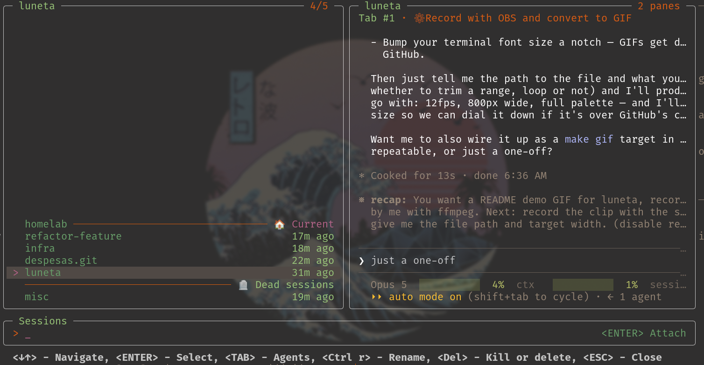
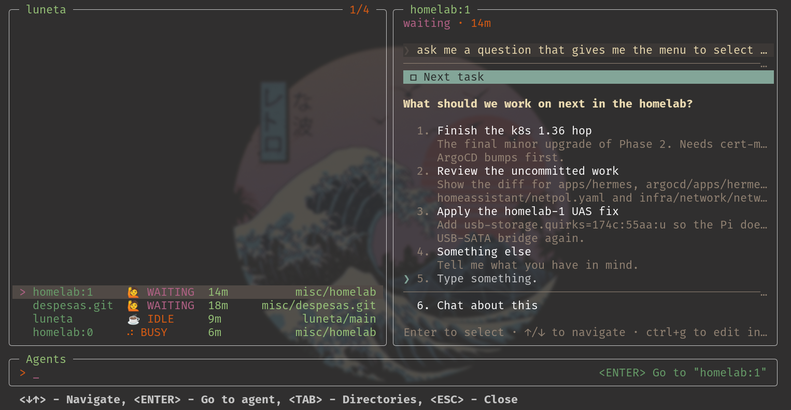
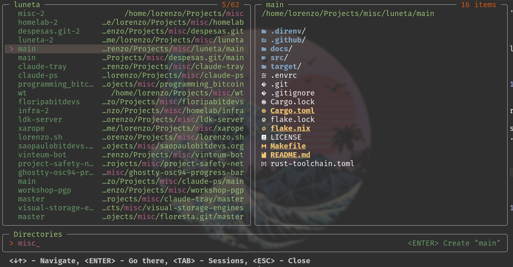

<h1 align="center">luneta</h1>

<p align="center">
  <em>A telescope-style picker for <a href="https://zellij.dev">zellij</a>.<br>
  Type a few characters, press <code>Enter</code>, and you are there.</em>
</p>

<p align="center">
  <a href="https://github.com/lorenzolfm/luneta/releases/latest"></a>
  <a href="#license"></a>
  
</p>

<!--
  MEDIA SLOT — hero.gif
  Record with `vhs docs/media/hero.tape` (nix shell nixpkgs#vhs), after a
  `dev install`. The tapes press real keys against the installed .wasm, so what
  lands in a GIF is the plugin and not a mock: they assume zoxide, eza and
  claude-ps on the PATH, a populated zoxide database, a running Claude Code
  agent, and a Nerd Font.
  Then point the  below at docs/media/hero.gif.
-->
<p align="center"></p>

---

## What is luneta

A replacement for zellij's default session picker, with sessions, agents and directories tabs.

* Create, hop between and delete sessions
* Jump to the agent that is waiting for you
* Create a session in a directory you work in
* Keep every session and agent in sight, in a [sidebar](#sidebar) pinned to each tab
* Start an agent on a skill with a few keys, from a [menu](#menu) of your own, and
  open a pane, a tab or a session, or close a pane or kill a session, with two
* Come back from a break to a [brief](#brief) of what your agents are doing

| `Tab` | list | `Enter` |
|---|---|---|
| 1 | **Sessions** — live and resurrectable, newest first | attach, resurrect, or create |
| 2 | **Agents** — the agents running and their status | jump to that agent's pane |
| 3 | **Directories** — where you work, in frecency order | create a session there |

Select an item to see a live preview of it.

### Agents

<!--
  MEDIA SLOT — agents.gif
  Record with `vhs docs/media/agents.tape`; swap the  src for docs/media/agents.gif once it exists.
-->
<p align="center"></p>

Know which agents need your attention, and jump straight to them.

| | status | meaning |
|---|---|---|
| 🙋 | `waiting` | it asked you something and stopped |
| ☕ | `idle` | it finished and is waiting for you |
| ⠋⠙⠹⠸ | `busy` | a spinner — the one status that ends on its own |
| 🐚 | `shell` | it is a shell |
| 🛸 | anything else | unknown, and visibly so |

Agents keep their place, as sessions do: in the order of their sessions in the
session list, the one you are in first and then the others newest first, and in
the order their panes were opened within each. Which agent wants you is the job
of the glyph, not of the order. The agent in the pane you came from is pinned
above the list.

An agent goes by the name its row has in the [sidebar](#sidebar): the name you
gave it with `/rename`, or else the title Claude Code gives its pane, its tab or
its directory. Two agents named alike are told apart by their panes, as
`luneta/main:4`, and by their sessions too when they sit in two, as
`luneta/main (review:4)`. A search finds an agent by what its row shows, the
pane that tells it apart as well, or by its session's name.

A pane holds one agent, as it does in the sidebar. A `claude -p` an agent runs
has its pane's ids, and claude-ps puts it in that pane too: the list shows the
agent you started at a prompt, or with an older claude-ps that does not say how
an agent started, the one that started first, and says below it how many it
left out. An agent only guessed into a pane gives way to the one whose session
names that pane, and counts among those luneta cannot find.

`Del` closes the pane the highlighted agent is in, and its tab with it when
nothing else holds the tab open: neither the sidebar's column nor a floating
pane does. That goes for a session nobody is attached to as well, where no dock
is there to close the tab. When the pane is a guess, `Del` leaves it alone and
says so: the agent names a session that is still running, but its pane turned
up in another, matched by its id and directory alone.

Needs [`claude-ps`](https://github.com/lorenzolfm/claude-ps) on the server's
`PATH`. Without it, the other two lists work exactly as before.

Agent support, today:

| agent | status |
|---|---|
| [Claude Code](https://claude.com/claude-code) | supported, through [`claude-ps`](https://github.com/lorenzolfm/claude-ps) |
| anything else | not yet |

### Directories

<!--
  MEDIA SLOT — dirs.gif
  Record with `vhs docs/media/dirs.tape`; swap the  src for docs/media/dirs.gif once it exists.
-->
<p align="center"></p>

Lists the directories you work in, in frecency order, and lets you create a new session right where you want to be.

A session is named for its directory. A git worktree is named for its repository too, wherever it lives, as `luneta-main`, where `main` alone would name a worktree of every repository. A bare repository's `.git` is left off, so `infra.git/master` is `infra-master`, and a worktree whose name already starts with its repository's, as `app-hotfix` beside `app`, keeps it. So does one whose name would come out too long for zellij to make a session of it.

---

### Sidebar

The same plugin, docked to the left of the tab you are in instead of floating
over it: every live session, the panes in it, and what the agent in each pane
is doing. One sidebar for the whole session, which follows you from tab to tab.

```text
─ 3 sessions ────── ●1 •2 ⠋3 ─

 ▾ bipa ────────────────── ●1
  •✓ handoff-eng-11259-p… 13h
     eng-11259-pr4b         ⇡
   ● dda-bank-slip-paid-…  3m
     dda-bank-slip-paid    !?
   ✓ Handoff pix outflow…  2h
     pix-outflow-readback !+?
 ▸ floresta ─────────────── ⠋
 ▾ unnamed ──────────────────
▌  ⠋ orca-copy            12s
▌    main
   ⠋ cargo build --relea… 42s
     main
  •✗ cargo test            8s
     main
```

Sessions keep their place, oldest first, so a row never moves under your eye
or your mouse. Which pane wants you is the job of its marks and the count on
its session's row — not of the order.

The sidebar marks a status with a dot one column wide where the picker has an
emoji, so that every label starts at the same column and the dot can take a
colour: `●` in the accent for `waiting`, `✓` in green for `idle`, the spinner
for `busy`, and `$`, dimmed, for `shell`. Any other status shows its initial.
The rule along the top counts the live sessions, the agents that wait for you,
what is new, and the agents at work, across all of them, a folded session's
too. A count of none is left out.

A `•` before a pane's mark says that something finished there since you were
last in it: an agent, its `✓` in green, or a command in a shell, with the row
named for the command and its age counting from when it ended. Once you go
there, the `•` goes: the agent keeps its `✓`, dimmed, and the shell is the plain row
it was. You were in a pane once you stayed there a second, so one you only
pass through keeps its `•`; the pane you are in has none, as you see it. A
folded session shows the `•` when any of its panes has one, over an agent at
work.

A command in a shell has the marks an agent has, once it has run for a
second: the spinner while it works, and `●` in the accent while it waits for
you to type, as a password prompt or a `[y/N]` does, with its row named for
the whole command and its age counting up. Once it ends, it has `✓` in green
for an exit status of 0, or `✗` in red for any other, after the `•`. A command
that ends within a second gets none of it: an `ls` is no news. A program that
takes the terminal over a key at a time, as an editor, a pager or `ssh` does,
runs for as long as you use it, and has no mark while it does. Nor does a job
you stop with `Ctrl z`, until `fg` brings it back under its own name, and
it ends with `$`, as fish does not say how; and a command that runs `exec`
gives the pane to another program, and the shell says no more of it. The rule along the top counts a command that waits for you with
the agents that wait for you, and one at work with the agents at work.

That takes the [hook](#hook-the-shell) in your shell, which says what it runs
and how it ended. The terminal says whether the command works or waits for
you: how it takes keys, and whether a process in front of it reads it. A
command that waits on the network with a blocking read looks, to Linux, like
one that reads the terminal, and has the `●` too. `sudo` and `script` run the
command on a terminal of their own, and keep yours a key at a time to pass
the keys on: the command goes by theirs. sudo's is root's, which says neither
how it takes keys nor where its processes sleep, so there a shell, an editor,
a pager or `ssh` in front has no mark, and anything else has the spinner, even
as it asks you something.

Without the hook, a shell says what it is doing in its title, as fish titles
its pane: the command it runs, cut to twenty characters, before its
directory, and the directory alone at the prompt. A command finished when the
one gives way to the other, and has `$` where the hook would say `✓` or `✗`;
while it runs it has no mark. One that ends within a second is never seen
running, and gets no `•`; nor does a command in a shell whose title says
neither, as bash's and zsh's do not, or one in a program that titles the pane
itself. zellij lists every session's titles some seconds late, so a command
you watch end, and leave the pane or the session right after, is seen by the
title its pane gives itself at once.

What you have seen, and what each shell ran, is the same in the sidebar of
every session, and outlasts zellij: the sidebars keep it in the plugin's cache,
beside the folds. A session renamed takes it along, whether the picker or
zellij renamed it, and a session gone for good takes it with it: one made
later by the same name starts with none of it, as a pane closed for good does.
Each session's sidebar asks claude-ps itself, which dates a status to the
whole second, so they may date one finish two seconds apart: an agent that
finishes within three seconds of your last time in its pane counts as one you
saw.

After the dot, an icon says what runs in the pane: Claude's for an agent, a
terminal for a shell, neovim's for nvim. It has a column of its own, so every
label still starts at the same column, and a program with no icon leaves the
column blank. What runs is the agent claude-ps finds in the pane, or else
what zellij says the pane's terminal has in front, by its binary's name: the
program you started, or the shell itself at its prompt. `sudo`, `env` and
`nix run` give way to what they run. zellij is asked every few seconds, so
a program shows its icon a few seconds after it starts.

| icon | Nerd Fonts name | for |
|---|---|---|
| Claude | `cod-claude` | an agent, and `claude` |
| a terminal | `dev-terminal` | `bash`, `fish`, `nu`, `sh`, `zsh` |
| neovim | `custom-neovim` | `nvim`, `vim` |
| rust | `dev-rust` | `cargo` |
| python | `dev-python` | `python`, `python3` |
| docker | `dev-docker` | `docker` |
| ssh | `dev-ssh` | `ssh` |
| git | `dev-git` | `git`, `lazygit` |
| a pulse | `cod-pulse` | `htop` |

The icons are a [Nerd Font](https://www.nerdfonts.com)'s, as the directory
preview's are. Claude's came with Nerd Fonts 3.5.0, and ssh's with 3.3.0: an
older font has neither, and the terminal draws a box or nothing for them, on
every agent's row for Claude's. In a font whose name ends in "Mono",
an icon takes one column; in the others it can spill into the space after
it. The sidebars drawn on this page leave the icons out.

Give a program an icon of your own, or take one away, by its binary's name,
in the alias's `icons`; `icons false` turns them off:

```kdl
plugins {
    luneta location="https://github.com/lorenzolfm/luneta/releases/download/v0.2.2/luneta-0.2.2.wasm" {
        icons {
            lazydocker "\u{e7b0}"   // docker's
            htop ""                 // none
        }
    }
}
```

An icon takes one column or two. An `icons` luneta cannot read, or an icon of
another width, says what is wrong with it under the sidebar's tree, and
leaves luneta's in its place.

An agent's row is named for what it is doing: the name you gave it with
`/rename`, or else the title Claude Code gives its pane. That title is a bare
`Claude Code` until the agent has a topic, and some never get one; such a row
goes by its tab, if you named it, or else by the directory the agent works in.
A pane with no agent in it is dimmed. `▌` marks the pane you are in, and the
highlight stays on it while the sidebar does not have the focus; once it has,
the highlight goes with the cursor. The session you are in has its rule in the
accent. A shell at its prompt is named for its directory's last two parts, as
`luneta/main`, where fish would title it `~/P/m/l/main`, or over SSH
`[host] ~/P/m/l/main`.

Under a pane's row, dimmed, is the branch checked out in the directory the pane
works in, and under the age, how its work tree stands, in the glyphs
[starship](https://starship.rs/config/#git-status) shows by default:

| | means |
|---|---|
| `=` | a conflict |
| `$` | a stash |
| `✘` | a deleted file |
| `»` | a renamed file |
| `!` | a modified file |
| `+` | a staged change |
| `?` | an untracked file |
| `⇡` `⇣` `⇕` | commits ahead of the upstream, behind it, or both |

A pane outside a repository, or on a detached `HEAD`, has no branch, and its row
stays one line. `git` is asked again every five seconds, so a change or a
checkout shows a few seconds later.

Click a pane's row, or focus the sidebar and press `Enter`, to go there — across
tabs and sessions alike. One click does it, whether the sidebar has the focus or
not. A session's row heads its panes, and is no place to go: the highlight
passes over it, from the last pane of one session to the first of the next, and
a click on its name does nothing, but bring the focus into the sidebar, as a
click anywhere on it does. On a session's row, the `▾` or `▸` folds or
unfolds the session. A folded session stands in for its panes: the highlight
stops on its row, and it switches to the session, on the pane it last had the
focus on; the session you are in takes you back to your pane. It keeps its
count and shows the dot of the agent that wants you most. A fold holds in the
sidebar of every session, and after zellij restarts: the sidebars keep their
folds in the cache zellij gives the plugin, one for each location it loads
from, so every session's `load_plugins` names the same one. A session the
picker deletes takes its fold with it: one made later by the same name starts
unfolded.

The wheel scrolls the list and leaves the highlight where it is, until you go
somewhere else or press a key. A click on a row it scrolled to lights the row
where it stands, and the list stays put. Leaving a session from the sidebar
hands its focus back to the pane you came from first, so the session has you
back there and not in the sidebar.

Press `/` to search, as in less and vim. The tree narrows to the rows that
match what you type, fuzzily, as the picker does: a session by its name, a pane
by its row, its branch, its tab or its directory. The rows left keep their order, and the
highlight lands on the best match, so `Ctrl b` `/` *a few characters* `Enter`
takes you anywhere. A folded session opens to show the panes found in it, and
a session found by its name shows all of its panes, the highlight on the one
that matches best, or else on the first.

One key goes to the next pane listed, and from the last back to the first, so
pressing it again and again takes you down the sidebar, across sessions. A
folded session's panes are left out.

The sidebar and the picker keep your place as you go from one to the other.
A key that opens the picker from the sidebar opens it on the row you had
highlighted: Sessions on its session, Agents on the agent in its pane, or else
the first agent in its session. `Ctrl b` from the picker closes it and
highlights, in the sidebar, the agent the picker had, unfolding its session, or
the first pane of the session it had, or that session's row while it is folded.

One key hides the sidebar, the panes beside it taking its columns in every tab,
and brings it back. Either goes for every session, within a second, and for a
session started later: the docks keep it in the plugin's cache, beside the
folds.

### Menu

Keys, pressed one after another, that start an agent on a skill, beside the
agent whose work it is for, open a pane, a tab or a session where it works, or
delete what you are done with. The menu shows the keys of the group you are in
and what each does, as which-key does in neovim.

```text
─ 2 sessions ──────────── ⠋1 ─

 ▾ luneta ───────────────────
▌  ⠋ fold                 12s
▌    feat/sidebar           !
     luneta/main
     main
 ▸ elo ──────────────────────
─ Claude ──── luneta/sidebar ─
 t  /thermo-nuclear-review
 m  /make-illegal-states-unr…
 s  /tigerstyle
 <BS> - Back, <ESC> - Close
```

In the sidebar, the menu's keys are the sidebar's. On the row of a pane, here
the agent `fold`, `c` opens the group you named Claude at the bottom of the
sidebar, and `t` starts Claude Code on `/thermo-nuclear-review` in a pane of its
own, beside that pane in its tab, and in the directory it works in, which the
rule over the keys names. For `/thermo-nuclear-review` that is the point: it
reviews the branch checked out there. A row of another tab takes you to that
tab, and a row of another session starts the agent in that session and takes
you there, handing the session you leave the pane you came from. A key the
sidebar has a use of its own for, as `j`, `/` or `b`, stays the sidebar's: `m`
opens the menu on its first group, where every key is the menu's. The menu
closes when the sidebar loses the focus, and with a click.

While the sidebar has the focus and no menu is open, its bottom shows the keys
you can press there: `/` to search at the top, then the menu's first group,
then the [brief](#brief)'s keys, in a group `b` opens. A key of the menu that a
command has stays the command's, and one the sidebar moves, folds or opens the
menu with, as `j` or `m`, is left out: `m` reaches it.

```text
─ luneta ─────────────────────
 /  Search
 c  Claude ▸
 n  New ▸
 d  Delete ▸
 b  Brief ▸
```

Your key opens the same menu floating at the bottom right of the tab, for the
pane you are in. In the sidebar, or any pane that is no terminal, it has no
pane to start an agent beside, and says so in place of its keys. So it does for
a pane whose directory zellij has yet to say: an agent starts where its pane
works, or not at all.

An agent started on a skill goes by the skill and the branch, as
`thermo-nuclear-review: feat/sidebar`, as though you had named it with
`/rename`, so the sidebar and the picker say what it is doing from the start.

What a key starts on is the first message of the session, as
`claude "/tigerstyle"` would take it: a skill, a skill and its arguments, as
`/code-review since main`, or words. `Backspace` goes back a group, and out of
the menu from the first; `Esc` closes it.

Your keys are for the few skills you run all the time. For any other, `/` at
the top of the menu searches every skill the pane's directory can run, as the
sidebar's `/` searches its rows: what you type narrows the list, fuzzily, by a
skill's name and by what it says it does, the skills whose names match first,
and `Enter` starts an agent on the one highlighted, beside the pane, as a key
does. `↓` and `↑` move; `Esc` goes back to the keys, and so does `Backspace`
once there is nothing to take back. In the sidebar, `m` `/` opens it.

```text
─ Skills ─────── luneta/main ─
 /_
 /code-review  Review the ch…
 /diagnosing-bugs  Diagnose…
 /handoff  Hand the work off…
 /make-illegal-states-unrepr…
 /prototype  Build a throwaw…
 /research  Research a topic…
 /thermo-nuclear-review  Rev…
 /tigerstyle  Apply TigerSty…
 <↓↑>/<ENTER>/<ESC>
```

The list shows eight skills at most, and scrolls under the cursor. It keeps
the height of the skills found as you type, so nothing above it moves.

The skills are the ones Claude Code finds for that directory, as slash
commands, where it finds them:

- yours, in `~/.claude`, or in `CLAUDE_CONFIG_DIR`
- the project's, in the `.claude` of the directory and of each one above it,
  up to the top of its repository
- each plugin's that `claude plugin list` says is on there, as
  `/plugin:skill`, where the plugin's manifest says it keeps them

A skill is a `skills/<name>/SKILL.md`, a command a `commands/<name>.md`, and a
workflow a `workflows/<file>.js`, named as its `meta` names it. A skill whose
frontmatter says `user-invocable: false` is left out. The skills built into
Claude Code, and the ones it brings from claude.ai, are not where luneta looks,
and the list leaves them out. It is made again each time `/` opens it, which
takes a moment, mostly `claude plugin list`'s.

Every menu has luneta's own New group too, under `n`, with nothing to
configure, which opens where the highlighted pane works: `n p` your shell in a
pane of its own beside that pane, `n t` a tab of its session, and `n s` a
session, which you go to. The session is named as the picker's directories
name that directory, `luneta-main` for a worktree of `luneta`, with a `-2`
when a session has that name. The floating menu does the same for the pane you
are in. A pane of another session opens there, and you go to it, and so does a
tab of a session with a client. A tab of a session with none, as most are,
opens once you are there: zellij makes a tab as big as a client of its
session, and one with none would have no room for its panes. A session's row
has no pane, nor a directory to open in, and its `n` keys say so.

```text
─ New ─────────── luneta/main ─
 p  new pane
 t  new tab
 s  new session
 <BS> - Back, <ESC> - Close
```

Every menu has luneta's own Delete group too, under `d`, with nothing to
configure: `d d` deletes the highlighted row, and `d s` kills its session. On a
pane's row, `d d` closes the pane; on the row of a session that lists none of
its panes, folded or with none to list, it kills the session. The
floating menu does the same for the pane you are in, except in a tab with a
floating pane: the menu takes the floating focus from the pane you were in as
it opens, and zellij then says the pane under it has the focus, so luneta cannot
tell which you came from. There `d d` closes neither and says so, and goes on
doing so once the floating pane closes; `d s` still kills the session. A pane that is the last in
its tab to hold it open closes the tab with it, so no tab is left with nothing
in it but the sidebar's column; a pane another was opened in place of keeps the
tab open, since zellij brings that pane back. A pane of another session closes
through `zellij --session`, and the sidebar's highlight moves to the row after
it once it is gone. The session you are in is killed once you are in another,
the newest, which the picker lists first; with no other session to go to, the
menu says so and kills nothing. Closing the last pane that holds a session's
only tab open would end the session, so `d d` there deletes the session, as
`d s` does: it asks as for the session, and the session you are in goes once
you are in another. A delete from the sidebar leaves you in the sidebar, to go
on along its rows: when the tab it closes is the sidebar's own, the sidebar
opens again in the tab you land in, with the focus, and the session you go to
before the one you are in is killed has you in its sidebar.

When what a key deletes would end an agent that is busy or waiting on you, the
menu asks first, and says what goes:

```text
─ Delete ──────── luneta/main ─
 Close the pane? 1 agent, 1
 busy
 <y> Yes <BS> Back <ESC> Close
```

`y`, or the key again, goes ahead; `n` or `Backspace` goes back to the keys. An
idle agent or a shell goes without asking. An agent whose status luneta does
not know, or that reports none, may be at work, and asks. Without `claude-ps`,
luneta cannot tell, and asks every time.

Needs `claude` on the server's `PATH`, and `git` for the branch.

### Brief

A few lines on what your agents are doing, for coming back to them after a
break, written by a fast model from what each one's transcript says last.

```text
┌ luneta: brief of every session ──────────────────────────────────┐
│Brief of every session, at 18:42                                  │
│                                                                  │
│You have 3 sessions open:                                         │
│- cipher: an agent waits for CI to finish, to report how it went  │
│- luneta: the sidebar fold is done and waits for your review      │
│- dotfiles: your nvim config is fixed                             │
│                                                                  │
│<any key> - Close                                                 │
└──────────────────────────────────────────────────────────────────┘
```

In the sidebar, `b` opens the brief's keys, for the row the cursor is on, and
`Backspace` goes back to the rest of the sidebar's keys:

| keys | brief |
|---|---|
| `b` `z` | every session, a line each |
| `b` `s` | the row's session, a line for each agent in it |
| `b` `h` | the agent in the row's pane, in a few lines; on a session's row, its session |

The brief opens floating over the tab, and any key closes it. It says when it
was made, and nothing is kept: each key asks again, so a brief costs only when
you ask for one. With no agent to brief you on, or transcripts that could not
be read, the sidebar says so where the keys were.

For each agent, the model is told its session, its row's name, its status and
for how long, and its branch, as the sidebar knows them, and from the end of
its transcript: the title Claude Code gave it, what you last asked of it, and
its last few steps, what it said and what it ran. A brief reads 512 KiB of
those records at most, shared among the agents it covers: one of many agents
may tell fewer steps of each. It is asked to
use those alone. The transcript is the one Claude Code keeps in
`~/.claude/projects`, or under `CLAUDE_CONFIG_DIR`, by the session id
claude-ps gives; the model is told when it was not found there. Two agents a
session names alike are told apart by their panes, as `luneta/main:4`, and a
brief tells of 32 agents at most, and says how many it leaves out.

The model is `claude -p --model haiku`, on your Claude Code login, with no
tools, and in `--safe-mode`, so that none of your hooks, `CLAUDE.md` or MCP
servers come into it. A brief takes a few seconds. While it is asked, the
`claude` it runs has no zellij in its environment, and claude-ps places it in
no pane.

Needs `claude` and `claude-ps` on the server's `PATH`.

### luneta in your terminal

luneta is turning inside out: from a plugin in zellij to a program that runs
zellij. Type `luneta` in a terminal, and zellij runs in it beside a sidebar of
luneta's own, drawn by luneta and not by a plugin:

```text
─ 2 sessions ───────────── ●1 ─  Zellij (luneta-main)  Tab #1
                                ╭ Pane #1 ────────────────────
 ▾ luneta-main ──────────── ●1  │~/P/m/luneta/main ➜
   ● fold                   3m  │
     feat/sidebar            !  │
▌    luneta/main                │
▌    main                       │
 ▾ elo ───────────────────────  │
     elo/main                   │
```

`luneta` attaches to the session named for the directory you are in, as the
picker's [directories](#directories) name it, `luneta-main` in a worktree of
`luneta`, and makes it if none runs; `luneta <name>` attaches to that one.
Run in a pane of zellij, luneta will not attach to the session that pane is
in, as zellij will not: name another. When zellij ends, detached or quit, so
does luneta, and when it fails, luneta says what zellij said. zellij's keys
are yours as they were, but three, which luneta takes before zellij sees them,
whichever of the two has the keys:

- `Ctrl b` goes back and forth between zellij and the sidebar. A click goes to
  whichever you click.
- `Alt Tab` goes to the next pane the sidebar lists, across sessions, and from
  the last back to the first. A folded session lists none of its panes, so it
  goes past them.
- `Ctrl q` hides the sidebar, zellij taking its columns, and brings it back.
  `Ctrl b` brings it back too, and goes into it.

Claude Code binds `Ctrl b` to send a task to the background, and neither of
the other two. zellij's default config binds `Ctrl b` to tmux mode and `Ctrl q`
to quit. luneta takes all three first: if you use those, bind them to other
keys, in zellij's config or in Claude Code's `~/.claude/keybindings.json`.

The sidebar lists every session, oldest first, the panes in each, in the order
of their tabs, and what the agent in each pane is doing, with the branch under
it, all as [`lunetad`](#building-from-source) says: luneta starts the daemon
when none runs, and the sidebar says so at its bottom while it does not
answer. `j` and `k` move,
`h`, `l` and `Space` fold, `Enter` or a click goes to the pane, across sessions
too, and `Esc` goes back to zellij. The session zellij is in has its rule in
the accent, and `▌` marks the pane it is on. The highlight rests there while
the sidebar does not have the focus; once it has, the highlight goes with the
keys, and comes back as the sidebar gives the focus back. A move you make in
zellij, as with its keys, shows within two seconds, as the daemon asks zellij
that often; one the sidebar makes shows at once. Another client of the
session, as a plain `zellij attach`, moves no mark. A pane with no mark, of an
agent or of a command, is dimmed, and an icon says what runs in each, as in the plugin's
[sidebar](#sidebar), with the plugin's icons and a terminal for `dash` and
`elvish` too: `icons` does not change them here, as luneta has no
configuration of its own yet. `/` searches the rows, as the plugin's sidebar
does, with what you type at the bottom where the keys were; there `Enter` goes
to the highlighted row, and `Esc` clears the search. Giving zellij the keys
clears it too.

An agent's row is named as the plugin's sidebar names it: for the name you
gave it with `/rename`, or else for its topic, the title Claude Code gives its
pane. A bare `Claude Code` is no topic, and such a row goes by its tab, if you
named it, or else by the directory the agent works in. The daemon has the
title without the `✳` Claude Code leads it with, or the frame it turns there
while it works, so the title changes only as the topic does. A pane you
renamed in zellij has your name for its title, and no topic: its row goes by
its tab or its directory, where the plugin's goes by that name. A pane with no
agent in it goes by what runs in it, and a shell at its prompt by its
directory's last two parts.

A command in a shell with the [hook](#hook-the-shell) has the marks an agent
has, once it has run for a second, as in the plugin's sidebar: the spinner
while it works, `●` while it waits for you to type, and once it ends, `✓` for
an exit status of 0, `✗` for any other, or `$` where the shell does not say,
its row named for the command and its age counting up. A program that takes
the terminal over, as an editor does, and a job stopped with `Ctrl z` have
none, and nor does a command that ends within a second. lunetad reads what
the hook writes, and the terminal of each command that runs. A command that
ended keeps its mark until the shell runs another: the `•` of what you have
yet to see has not come over yet. A shell without the hook has no marks
here, where the plugin's sidebar read its title.

A fold is the same in every luneta on the host, and lasts until you unfold it:
each folded session is an empty file named for it in
`$XDG_STATE_HOME/luneta/folded`, or `~/.local/state/luneta/folded`, which every
luneta watches. A fold keeps to the session's name, so a session started again
under it comes back folded.

It is the first step, and the plugin's sidebar has more than this one does
yet: its menu, the brief and the `•` of what finished come over one at a time.
Until then, run luneta without the plugin's sidebar, or the two stand side by
side: leave the dock out of `load_plugins`, and `default_layout` back at
zellij's own, as [Dock the sidebar](#dock-the-sidebar) has them. The picker,
the menu and the brief are the plugin's still, and work in the zellij luneta
runs as in any other.

luneta's terminal tells zellij what it is told: the kitty keyboard protocol,
where the terminal you run luneta in speaks it, so that `Shift Enter` is not
`Enter`; what zellij copies, as OSC 52; and the session zellij is in, by the
title it gives the terminal, or else the session luneta sent it to: zellij
gives no title to a client that comes to a tab it last gave the same one. To
take zellij's client to a pane, luneta types a
`ScrollLock` let go into it first, which nothing binds, and which a shell, or
nvim as you type in it, passes over: zellij moves the client of a session that
last typed in it. With
`support_kitty_keyboard_protocol false` in zellij's config, the client cannot
read that key, and the sidebar takes it somewhere only once you have typed in
the session it is in.

## Getting started

### Requirements

| | | needed for |
|---|---|---|
| **zellij 0.45.0** | | everything |
| [`claude-ps`](https://github.com/lorenzolfm/claude-ps) | optional | the agent list and the brief |
| [`claude`](https://claude.com/claude-code) | optional | the menu and the brief |
| `git` | optional | the branch in the name of an agent the menu starts |
| [`zoxide`](https://github.com/ajeetdsouza/zoxide) | optional | the directory list |
| [`eza`](https://github.com/eza-community/eza) | optional | the directory preview |
| [`git`](https://git-scm.com) | optional | the branch and its status under a pane in the sidebar |
| a [Nerd Font](https://www.nerdfonts.com), 3.5.0 or later | optional | the icons in the sidebar, which `icons false` turns off |
| `luneta` and [`lunetad`](#building-from-source), side by side | optional | the sidebar's agents, panes and branches as they change, without each sidebar asking claude-ps, zellij and git |
| the [hook](#hook-the-shell) in fish | optional | a command's spinner in the sidebar, and how it ended |

The session list needs nothing but zellij. The optional tools are looked up by
name on the `PATH` of the zellij **server**, which is inherited from whatever
started it — on a long-lived session that can be older than your shell profile.
The font is not looked up: it is the terminal's you attach from, which over SSH
is the one on your own machine, not the server.

### Install

```kdl
plugins {
    // ...
    luneta location="https://github.com/lorenzolfm/luneta/releases/download/v0.2.2/luneta-0.2.2.wasm"
}
```

Zellij will prompt once for `RunCommands`, `ReadApplicationState`,
`ChangeApplicationState` and `OpenTerminalsOrPlugins`. `RunCommands` is how
luneta reaches `zoxide`, `eza`, `claude-ps`, `git`, `zellij` and `luneta`, and how
the [menu](#menu) starts `claude`; `OpenTerminalsOrPlugins` is how the
[dock](#dock-the-sidebar) opens the sidebar.
Every mode asks for all four, since zellij keeps one grant for a plugin.

<details>
<summary><strong>Prefer to verify the bytes first?</strong></summary>

Zellij does not check a checksum, a signature or an attestation on a plugin it
downloads — it fetches the URL and runs the bytes. Every release ships a
`SHA256SUMS` and a keyless build provenance attestation, so you can download,
check, and install from disk instead:

```sh
v=0.2.2
gh release download "v$v" -R lorenzolfm/luneta -p 'luneta-*.wasm' -p SHA256SUMS
sha256sum -c SHA256SUMS
gh attestation verify "luneta-$v.wasm" -R lorenzolfm/luneta
install -m 0644 "luneta-$v.wasm" ~/.local/share/zellij/plugins/luneta.wasm
```

`sha256sum -c` proves the bytes are complete. `gh attestation verify` proves where
they came from: built by `ci.yml`, at that commit, in this repo, on a GitHub
runner. Then point `config.kdl` at the `file:` path instead of the URL.

</details>

### Bind keys

Bind one key to open luneta and use `Tab` to cycle between the tabs, or bind separate keys that open the agents and directories tabs directly.

```kdl
keybinds {
    normal {
        bind "Ctrl j" {
            LaunchOrFocusPlugin "luneta" {
                floating true
                move_to_focused_tab true
            }
            SwitchToMode "normal"
        }
        bind "Ctrl a" {
            LaunchOrFocusPlugin "https://github.com/lorenzolfm/luneta/releases/download/v0.2.2/luneta-0.2.2.wasm" {
                floating true
                move_to_focused_tab true
            }
            MessagePlugin "https://github.com/lorenzolfm/luneta/releases/download/v0.2.2/luneta-0.2.2.wasm" {
                name "screen"
                payload "agents"
            }
            SwitchToMode "normal"
        }
        bind "Ctrl d" {
            LaunchOrFocusPlugin "https://github.com/lorenzolfm/luneta/releases/download/v0.2.2/luneta-0.2.2.wasm" {
                floating true
                move_to_focused_tab true
            }
            MessagePlugin "https://github.com/lorenzolfm/luneta/releases/download/v0.2.2/luneta-0.2.2.wasm" {
                name "screen"
                payload "dirs"
            }
            SwitchToMode "normal"
        }
    }
}
```

### Open the menu

The menu is the plugin in `mode "menu"`. Its keys are a `menu`, a node to a
key: a key's one string is what it starts an agent on, or, with keys inside
it, the name of the group they make. At the top of the menu, `/`, `n` and `d`
are luneta's, for its search, its New group and its Delete group, and a menu
that gives one of them a key of yours says so. Give them to the alias, so that
the key that opens the menu and the sidebar show the same keys:

```kdl
plugins {
    luneta location="https://github.com/lorenzolfm/luneta/releases/download/v0.2.2/luneta-0.2.2.wasm" {
        menu {
            c "Claude" {
                t "/thermo-nuclear-review"
                m "/make-illegal-states-unrepresentable"
                s "/tigerstyle"
            }
        }
    }
}

keybinds {
    normal {
        bind "Alt m" {
            LaunchOrFocusPlugin "luneta" {
                floating true
                move_to_focused_tab true
                mode "menu"
            }
            SwitchToMode "normal"
        }
    }
}
```

The sidebar has the keys of the dock that opened it, so load the dock by the
alias too, as [below](#dock-the-sidebar).

A key is one character, pressed bare. The key that opens the menu needs a
modifier: zellij hands a bare `m` to the pane you are in. A menu luneta cannot
read says what is wrong with it where its keys would be, and closes on any key.
A sidebar from a dock loaded by its location has none of the alias's keys, and
its `m` says to load the dock by the alias.

### Dock the sidebar

The sidebar is one pane for the whole session. The dock keeps it in the tab on
screen: the same plugin, in the background, loaded with every session in
`config.kdl`:

```kdl
load_plugins {
    luneta {
        mode "dock"
    }
}
```

`luneta` is the alias from [Install](#install), so the dock, and the sidebar it
opens, have whatever the alias is given: the [menu](#open-the-menu)'s keys, for
one.

A `mode` luneta does not know does nothing but say so, in its pane if it has
one and in zellij's log.

Every tab keeps a column for the sidebar to dock into: a placeholder, a pane that
runs `tail -f /dev/null`. Give it to every tab in a layout:

```kdl
// ~/.config/zellij/layouts/sidebar.kdl
layout {
    pane size=1 borderless=true {
        plugin location="zellij:tab-bar"
    }
    pane split_direction="vertical" {
        pane size=32 command="tail" {
            args "-f" "/dev/null"
        }
        pane focus=true
    }
    pane size=2 borderless=true {
        plugin location="zellij:status-bar"
    }
}
```

Leave the placeholder its border. Each time zellij arranges a tab, the pane in
the placeholder's place takes its `borderless`, the sidebar too, and zellij takes
a borderless plugin on the edge of the tab for part of its own frame, like the
tab bar, and draws no line between it and the panes beside it.

When another tab comes on screen, the sidebar hands its tab back the placeholder
and takes the new tab's, in its place, so the panes beside it never change size.
The dock opens the sidebar when the session starts, and again if the tab that
held it closes, with the focus if you were in it. Closing the sidebar hides it,
in every session. A tab closes with the last pane beside its column, as it would
without one, and the session ends with its last tab.

zellij opens every new tab of a session from the layout the session was made
with, so `default_layout "sidebar"` in `config.kdl` gives every tab of every new
session its column. Leave the `pane` in: a tab of nothing but the placeholder
closes as soon as it opens, so a session from a layout of nothing but a
`default_tab_template` ends as soon as it starts. A session that is already
running keeps its own layout, with no column to dock into; start it again.

A layout of your own leaves zellij's swap layouts behind: the ones `Alt [` and
`Alt ]` step through, and that arrange a tab as you open panes in it. Give the
layout its own, with the placeholder in a column of its own, in a file beside it.
zellij's, with every pane count one higher for the column:

```kdl
// ~/.config/zellij/layouts/sidebar.swap.kdl
tab_template name="ui" {
    pane size=1 borderless=true {
        plugin location="zellij:tab-bar"
    }
    pane split_direction="vertical" {
        pane size=32 command="tail" {
            args "-f" "/dev/null"
        }
        pane {
            children
        }
    }
    pane size=2 borderless=true {
        plugin location="zellij:status-bar"
    }
}

swap_tiled_layout name="vertical" {
    ui max_panes=6 {
        pane split_direction="vertical" {
            pane
            pane { children; }
        }
    }
    ui max_panes=9 {
        pane split_direction="vertical" {
            pane { children; }
            pane { pane; pane; pane; pane; }
        }
    }
    ui max_panes=13 {
        pane split_direction="vertical" {
            pane { children; }
            pane { pane; pane; pane; pane; }
            pane { pane; pane; pane; pane; }
        }
    }
}

swap_tiled_layout name="horizontal" {
    ui max_panes=5 {
        pane
        pane
    }
    ui max_panes=9 {
        pane {
            pane split_direction="vertical" { children; }
            pane split_direction="vertical" { pane; pane; pane; pane; }
        }
    }
    ui max_panes=13 {
        pane {
            pane split_direction="vertical" { children; }
            pane split_direction="vertical" { pane; pane; pane; pane; }
            pane split_direction="vertical" { pane; pane; pane; pane; }
        }
    }
}

swap_tiled_layout name="stacked" {
    ui min_panes=5 {
        pane stacked=true { children; }
    }
}

swap_tiled_layout name="half-stacked" {
    ui min_panes=6 {
        pane split_direction="vertical" {
            pane
            pane stacked=true { children; }
        }
    }
}
```

The floating ones, which do not touch the column, are the
`swap_floating_layout` blocks of `zellij setup --dump-swap-layout default`. The
sidebar needs the tiled ones to come back to its column after hiding, in a tab
of more than one terminal.

Key bindings drive it without moving your hands to it. A `MessagePlugin` with
no location goes to every plugin in the session: the dock answers `toggle`, the
sidebar `focus` and `cycle`, and the picker `focus` too, handing the sidebar
its row. Bind the ones you want:

```kdl
keybinds {
    normal {
        // Into the sidebar, and back out to the pane you came from.
        bind "Ctrl b" {
            MessagePlugin {
                name "sidebar"
                payload "focus"
            }
        }
        // The next pane the sidebar lists, and from the last back to the
        // first.
        bind "Ctrl f" {
            MessagePlugin {
                name "sidebar"
                payload "cycle"
            }
        }
        // Hide the sidebar, or bring it back.
        bind "Alt b" {
            MessagePlugin {
                name "sidebar"
                payload "toggle"
            }
        }
    }
}
```

zellij's own keys take `Ctrl b` into tmux mode: unbind it there, or pick
another key.

`Ctrl b` on a hidden sidebar brings it back and moves into it. A tab opened
while it is hidden opens with its column hidden too.

The keys that move the focus pass over the sidebar, as they pass over the tab
bar: `Alt h`, which zellij binds to move the focus left, goes on from the pane
beside the column to the tab before, and `Alt l` into a tab lands in the pane
beside its column. `Ctrl b` and a click are the ways in. zellij does not say
which key moved the focus, so one that moves it only within a tab, `h` in pane
mode, goes on to the tab before too.

zellij hands the sidebar no click that only focuses it, but it ends the hover
over the sidebar first, where the click was, and the sidebar acts on that. With
`mouse_hover_effects false` there is no hover: such a click only focuses the
sidebar, and from the pane beside the column reads as `Alt h`.
`mouse_click_through true` hands the sidebar the click itself. zellij hands a
plugin no right click, and no drag.

Two clients on one session — a terminal and `zellij web`, say — share the one
sidebar. It goes with whoever switched tabs last, and comes back from hidden to
the tab of the client that attached first. A key reaches the plugins of every
client, and zellij does not say whose it was, so `Ctrl b` and `Ctrl f` act
for both.

### Hook the shell

A command in a shell has its [marks in the sidebar](#sidebar) once the shell
says what it runs and how it ended. luneta cannot hook your shell for you: put
this in `~/.config/fish/conf.d/luneta.fish`.

```fish
# luneta: say what runs in each zellij pane, and how it ended.
if status is-interactive; and set -q ZELLIJ_PANE_ID; and test -t 0
    and test -n "$XDG_RUNTIME_DIR$TMPDIR"
    # A window opened from a pane has the pane's variables, and a terminal of
    # its own: a shell there is not the pane's.
    and not begin
        test "$__luneta_pane" = "$ZELLIJ_SESSION_NAME $ZELLIJ_PANE_ID"
        and test "$__luneta_pane_tty" != (tty)
    end
    set -gx __luneta_pane "$ZELLIJ_SESSION_NAME $ZELLIJ_PANE_ID"
    set -gx __luneta_pane_tty (tty)
    set -l root $XDG_RUNTIME_DIR
    test -n "$root"; or set root $TMPDIR
    set -g __luneta_root $root/luneta
    set -g __luneta_dir $__luneta_root/commands/$ZELLIJ_SESSION_NAME
    # The shell's own file, for its pane and when it started.
    set -q __luneta_file; or set -g __luneta_file $__luneta_dir/$ZELLIJ_PANE_ID.(date +%s)

    function __luneta_say
        # Yours alone, and no link to another: what runs says what you type.
        test -d $__luneta_root; or mkdir -m 700 $__luneta_root
        test -O $__luneta_root; and not test -L $__luneta_root; or return
        test -d $__luneta_dir; or mkdir -p $__luneta_dir; or return
        # Moved into place whole, as the sidebar reads it.
        printf '%s\n' "$argv" >$__luneta_file.new; and mv -f $__luneta_file.new $__luneta_file
    end

    function __luneta_going --on-event fish_preexec
        set -g __luneta_jobs (jobs --group)
        set -g __luneta_command (string replace -a \n ' ' -- $argv[1])
        # `exec` gives the pane to another program, and nothing would say how
        # this ended.
        if string match -qr '(^|[;&|]|\b(and|or|not))\s*exec(\s|$)' -- $argv[1]
            rm -f $__luneta_file
            return
        end
        # `fg` brings back the last job, which is what runs.
        if string match -qr '^\s*fg\s*$' -- $argv[1]
            set -l job (jobs --last | string split \t)
            if set -q job[1]
                set __luneta_command $job[-1]
                set __luneta_jobs (string match -v -- $job[2] $__luneta_jobs)
            end
        end
        __luneta_say going (date +%s) $__luneta_pane_tty $__luneta_command
    end

    function __luneta_ended --on-event fish_postexec
        set -l s $status
        # `fg` says 0 however the job it brought back ended.
        string match -qr '^\s*fg(\s|$)' -- $argv[1]; and set s -
        # `Ctrl z` stops the job, and gives the prompt back with a status of 0.
        set -l job (jobs --last --group)
        if set -q job[1]; and not contains -- $job $__luneta_jobs
            and ps -o stat= -p $job | string match -q 'T*'
            __luneta_say stopped (date +%s) $__luneta_command
        else
            __luneta_say ended (date +%s) $s $CMD_DURATION $__luneta_command
        end
    end

    function __luneta_gone --on-event fish_exit
        rm -f $__luneta_file
    end
end
```

A shell started before the hook was there has none: start it again, or
`source` the file in it.

The hook keeps a file for each shell, of one line, at
`$XDG_RUNTIME_DIR/luneta/commands/<session>/<pane>.<started>`, or under
`$TMPDIR` where that is not set, and takes it away as the shell exits. With
neither, it keeps none. The folder `luneta` is yours alone: the hook makes it
so, and neither it nor the sidebar uses one that another user made, or a link,
as anyone could make in a `TMPDIR` of `/tmp`. It writes the line beside it first and moves it into place, so that the
sidebar never reads half of one. Another shell can be hooked to write the same
line, which is one of

```text
going <since> <tty> <command>
ended <at> <status> <took> <command>
stopped <at> <command>
```

with `<started>`, `<since>` and `<at>` in seconds since the epoch, `<took>` in
milliseconds, `<status>` the exit status, or `-` where the shell cannot say it,
as fish cannot after `fg`, `<tty>` the path `tty` prints, the command on one
line, and `stopped` for a job stopped with `Ctrl z`. The plugin's sidebar reads the files every
second, through `sh`, `stty`, `ps` and `awk` on the zellij server's `PATH`,
and the server must see the same `XDG_RUNTIME_DIR` as the shells in its panes.
luneta's own sidebar has them from lunetad, which keeps its socket in the same
folder: it reads a file as it changes, and the terminal of each command that
runs every second, through `ps` on its `PATH`.
A pane's shell is the one that started last on its terminal, and one that
started before its session was made is another session's. A shell in a window
opened from the pane has the pane's variables, which the hook passes on, and a
terminal of its own: it says nothing.

A shell started before its session was renamed goes on writing under the old
name, and so does one started again in a pane the session had then, as the
pane's variables still say that name; a pane opened since says the new one. In
the plugin's sidebar, the commands of those shells have no marks; nor does a
session made later by the old name take them for its own. lunetad follows the
session to its new name, as it does an agent, when it saw the rename: a
session renamed before lunetad started leaves those shells unmarked. A session
made later under the old name, in both sidebars, has the shells started in it
since, and so does a shell started since in an old pane of the one renamed,
which says the old name too.

A shell killed with `kill -9`, or by the kernel when memory runs out, cannot
take its file away, and the file stays until you log out. One that ran in a
pane's shell stands in front of the pane's own, in both sidebars, until you
take its file away with `rm`. lunetad drops a command going on a terminal that
is gone, but only until another terminal is opened, which takes the gone
one's number.

---

## Usage

Press your key, type, press `Enter`.

| key | does |
|---|---|
| *any character* | filter, fuzzily |
| `↓` / `↑` | move the highlight |
| `Enter` | act on the highlighted row — the prompt says which action |
| `Tab` / `Shift-Tab` | next / previous list, keeping the search term |
| `Ctrl-r` | rename the session you are in |
| `Del` | kill a live session, or delete a dead one; close an agent's pane, and its tab once nothing else holds it open |
| `Backspace` | delete a character |
| `Esc` / `Ctrl-c` | close |

In the sidebar, once it has the focus:

| key | does |
|---|---|
| `↓` `↑` / `j` `k` | move the highlight, from pane to pane |
| `Enter` | go to the highlighted pane, or switch to the highlighted folded session |
| `←` `→` / `h` `l` | fold / unfold the session |
| `Space` | fold or unfold |
| *a key of the [menu](#menu)* | open its group, or start its agent, for the highlighted pane |
| `m` | open the menu on its first group, for the highlighted pane |
| `b` | open the [brief](#brief)'s keys, for the highlighted row |
| `/` | search |
| `Esc` | back to the pane you came from |

With the mouse, focused or not:

| mouse | does |
|---|---|
| click a pane, or a folded session | go there |
| click `▾` / `▸` | fold / unfold the session |
| wheel | scroll the list |

While the search is open, every key types into it but these:

| key | does |
|---|---|
| `↓` / `↑` | move the highlight |
| `Enter` | go to the highlighted row, and close the search |
| `Esc` | close the search, and clear it |
| `Backspace` | delete a character, or close the search once it is empty |

In the menu:

| key | does |
|---|---|
| *a key it shows* | open its group, start its agent, or run the sidebar's command |
| `n p` | open your shell in a pane beside the highlighted pane |
| `n t` | open a tab of the highlighted pane's session |
| `n s` | start a session where the highlighted pane works, and go there |
| `d d` | close the highlighted pane, or kill the highlighted session |
| `d s` | kill the highlighted row's session |
| `y`, or the key again | go ahead with a delete that asked first |
| `n` | back to the keys, from a delete that asked first |
| `Backspace` | back a group, or close from the first; back to the keys from a delete that asked |
| `Esc` / `Ctrl-c` | close |

---

## Building from source

Only if you would rather not install a downloaded `.wasm`.

```sh
nix develop          # or: direnv allow, once
dev install          # builds and installs to ~/.local/share/zellij/plugins/luneta.wasm
```

The flake pins the rust toolchain with `wasm32-wasip1` added; a system rustc
without that target fails with `error[E0463]: can't find crate for 'std'`.

For the artifact a release ships — every dependency at the revision `Cargo.lock`
names, built in a sandbox, no devshell and no checkout needed:

```sh
nix build github:lorenzolfm/luneta   # -> result/luneta.wasm
```

The flake builds on `x86_64-linux`, `aarch64-linux` and `aarch64-darwin`. A
release is the `x86_64-linux` build; the others work the same, but are not the
same bytes, as the paths a build runs in are written into the `.wasm`. On any
other system, build with cargo instead, on the toolchain `rust-toolchain.toml`
names and with `protoc` on the `PATH`, for the daemon's protocol the plugin
reads: `cargo build --release --target wasm32-wasip1` writes
`target/wasm32-wasip1/release/luneta-plugin.wasm`, which you install as
`~/.local/share/zellij/plugins/luneta.wasm`.

Then point `config.kdl` at `file:` instead of the release URL:

```kdl
plugins {
    luneta location="file:~/.local/share/zellij/plugins/luneta.wasm"
}
```

`nix build .#lunetad` builds `lunetad`, the daemon that holds what luneta
knows of a host, and `luneta`: zellij beside a sidebar, as
[luneta in your terminal](#luneta-in-your-terminal) has it, and with a command,
the CLI that talks to the daemon
([#95](https://github.com/lorenzolfm/luneta/issues/95)). With `luneta` on the
zellij server's `PATH`, the sidebar and the picker take the panes of each
session, the branch each works on and the agents from the daemon, through
`luneta watch`, as they change. Without it, each asks claude-ps, zellij and git
itself, as before, and the daemon again every few seconds.

Nothing has to start the daemon, or run it as a service: `luneta` and `luneta
watch` start `lunetad` when none answers, as zellij and tmux start their
servers. They start the `lunetad` beside them, which the same build made, or
else the first on the `PATH`, detached, with what it says in `lunetad.log`
beside its socket, in `$XDG_RUNTIME_DIR/luneta` (`$TMPDIR/luneta` on macOS).
It lives as long as zellij does, not as long as a client is attached: once
zellij has had no session for 30 seconds, it ends. A daemon older than them,
as an upgrade leaves running, they stop, and start their own in its place. A
newer one they keep, so that two versions in use at once never take turns at
it: after a rollback, the newer daemon runs on until zellij's last session ends.
`luneta info` says which daemon runs, `luneta agents` lists the agents it
finds, and `luneta sessions` the sessions, their panes and the branch each
works on; none of the three starts one. The daemon asks `zellij` and `git` on
its `PATH`, which is the zellij server's when the plugin started it.

## License

MIT. Zellij is MIT-licensed too.
