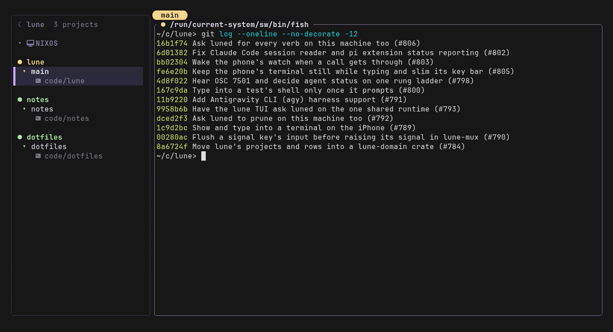

# lune

The terminals of a worktree beside a sidebar of every project, on this machine
and on the others you watch, and what the agent in each terminal is doing.



- A **project** is a folder: the root of a clone that
  [`wt clone`](https://github.com/lorenzolfm/wt) made, which holds each of its
  worktrees, or a plain folder, whose one worktree is the folder itself.
- A **worktree** has a row in the sidebar once you open it. Its **views** are
  terminals of `lune-mux`, lune's own multiplexer, each running a shell or an
  agent (Claude Code, pi or Antigravity).
- **luned**, lune's daemon, keeps the projects, their worktrees and their views,
  and watches the agents in them. It outlives `lune`, so the shells and agents
  keep running when you close it.
- luned can watch other machines over ssh, and an iPhone app reaches it over
  Tailscale.

## Install

lune builds with Nix, on `x86_64-linux`, `aarch64-linux` and `aarch64-darwin`.
The flake's default package holds `lune`, `luned` and `lune-mux`:

```sh
nix profile add github:lorenzolfm/lune
```

An older Nix, which knows no `nix profile add`, calls it `nix profile install`.

Or add `lune.packages.${system}.default` to your NixOS, nix-darwin or
home-manager configuration, with `github:lorenzolfm/lune` as the `lune` input.

lune calls these programs when it finds them on the `PATH`:

| Program | For |
| --- | --- |
| `git` | worktrees, branches and their status |
| `gh`, logged in | pull requests, issues and their checks |
| `zoxide` | the folders you work in, to open as projects |
| `eza` | listing a folder's contents |
| `claude`, `pi`, `agy` | the agents a view runs; `claude -p` also answers lune's ask box |
| `ssh` | watching another machine, which needs lune installed there too |

lune makes worktrees with [wt](https://github.com/lorenzolfm/wt)'s code, built
in, and never runs `wt`. You need it yourself for `wt clone`, which lays out a
clone with a folder per worktree, as lune expects of a project with several
worktrees.

## Run

```sh
lune                 # the worktree of this folder, or the one you used last
lune <project>       # that project; outside every project, one of that name made of this folder
lune start '#42'     # a worktree issue-42, with an agent told to tackle the issue
lune --help          # every command
```

`lune` starts luned if none runs, and luned starts `lune-mux` when it needs a
terminal. `Alt a` opens the menu and `Super k` the palette, which list each
action with its key.

[`skills/lune/SKILL.md`](skills/lune/SKILL.md) teaches an agent the `lune`
commands, and is the best tour of what they do.

## Develop

```sh
nix develop          # the pinned toolchain, and `dev`
dev help             # every recipe
dev install          # build this checkout into ~/.cargo/bin, and end luned for lune to start yours
dev test             # the tests, on nextest
dev clippy && dev lint
```

Plain `cargo` outside `nix develop` fails: the build needs libghostty-vt and
the speech libraries the shell provides. The iPhone app builds on a Mac with
`dev ios`.

[`docs/architecture.md`](docs/architecture.md) says which process and crate
does what. `vhs docs/media/lune.tape` records the screenshot above again (with
`fish` as your login shell).

## License

[MIT](LICENSE)
