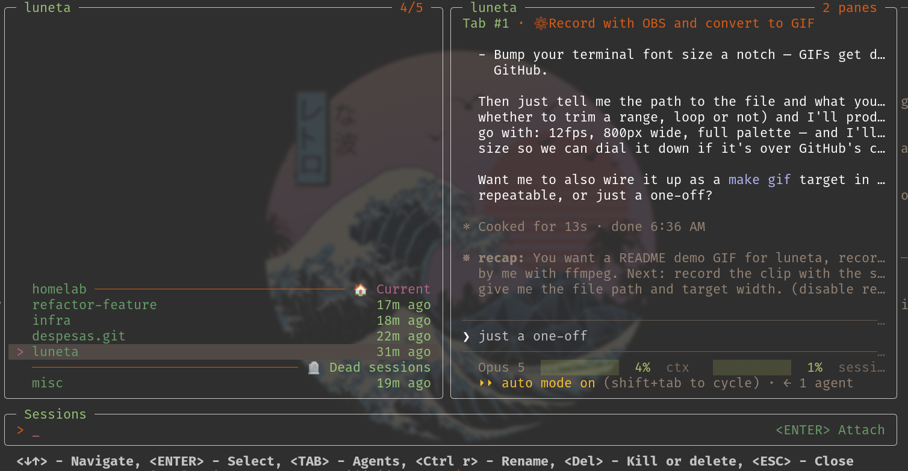
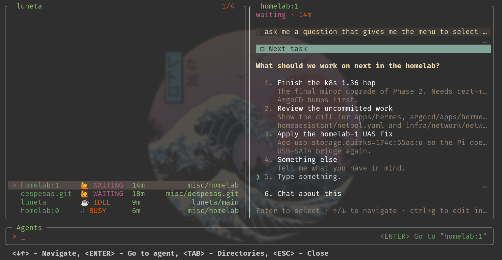
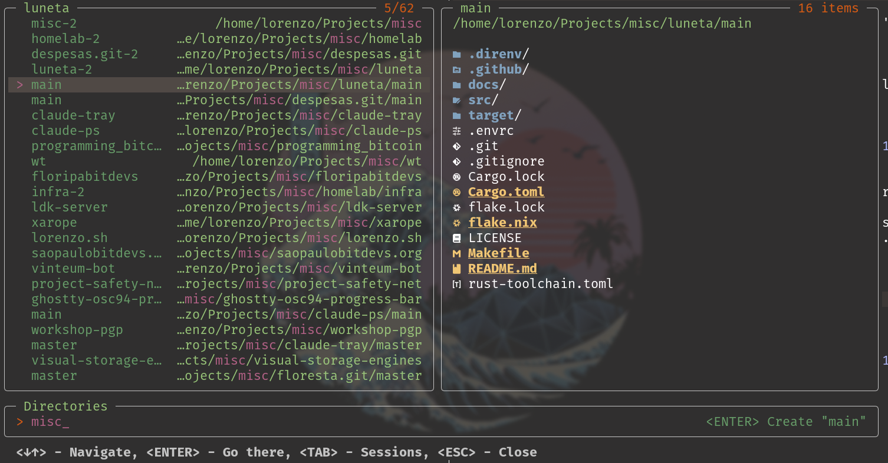

<h1 align="center">luneta</h1>

<p align="center">
  <em><a href="https://zellij.dev">zellij</a> beside a sidebar of every session and agent, with a telescope-style picker over it.<br>
  Type a few characters, press <code>Enter</code>, and you are there.</em>
</p>

<p align="center">
  <a href="#license"></a>
  
</p>

<!--
  MEDIA SLOT — hero.gif
  Record with `vhs docs/media/hero.tape` (nix shell nixpkgs#vhs). The tapes
  press real keys against luneta, so what lands in a GIF is luneta and not a
  mock: they assume zoxide, eza, luneta and lunetad on the PATH, a populated
  zoxide database, a running Claude Code agent, and a Nerd Font.
  Then point the  below at docs/media/hero.gif.
-->
<p align="center"></p>

---

## What is luneta

zellij in your terminal, beside a sidebar of every session and agent, and a
picker over it with sessions, agents and directories tabs.

* Create, hop between and delete sessions
* Jump to the agent that is waiting for you
* Create a session in a directory you work in
* Keep every session and agent in sight, in a [sidebar](#luneta-in-your-terminal) beside zellij
* Start an agent on a skill with a few keys, from a [menu](#menu) of your own, and
  open a pane, a tab or a session, or close a pane or kill a session, with two
* Come back from a break to a [brief](#brief) of what your agents are doing
* [Tell an agent](#tell-an-agent) what you want in words: a session to work on
  something, an agent on each of four issues, every session closed. Tell the
  agent you're talking to, or [luneta's sidebar](#from-lunetas-sidebar)
* [Dictate](#dictate) to an agent, or to the ask box, by a speech model that
  runs on your machine: hold `Alt r` and talk
* Have what you selected [read aloud](#read-aloud), and an agent on any of your
  machines tell you how its work goes, out of the speakers where you sit
* Get a [notification](#notifications) when an agent on any of your machines
  wants you, gone as soon as it no longer does

| `Tab` | list | `Enter` |
|---|---|---|
| 1 | **Sessions** — live and resurrectable, newest first | attach, resurrect, or create |
| 2 | **Agents** — the agents running and their status | jump to that agent's pane |
| 3 | **Directories** — where you work, in frecency order | create a session there |

Select an item to see a live preview of it.

### Agents

<!--
  MEDIA SLOT — agents.gif
  Record with `vhs docs/media/agents.tape`; swap the  src for docs/media/agents.gif once it exists.
-->
<p align="center"></p>

Know which agents need your attention, and jump straight to them.

| | status | meaning |
|---|---|---|
| 🙋 | `waiting` | it asked you something and stopped |
| ☕ | `idle` | it finished and is waiting for you |
| ⠋⠙⠹⠸ | `busy` | a spinner — the one status that ends on its own |
| 🐚 | `shell` | it is a shell |
| 🛸 | anything else | unknown, and visibly so |

Agents keep their place, as sessions do: in the order of their sessions in the
session list, the one you are in first and then the others newest first, and in
the order their panes were opened within each. Which agent wants you is the job
of the glyph, not of the order. The agent in the pane you came from is pinned
above the list.

An agent goes by the name you gave it with `/rename`, or else [its
topic](#luneta-in-your-terminal), the title Claude Code gives its pane, its tab or its
directory. Two agents named alike are told apart by their panes, as
`luneta/main:4`, and by their sessions too when they sit in two, as
`luneta/main (review:4)`. A search finds an agent by what its row shows, the
pane that tells it apart as well, by its session's name, or by the last two
parts of its directory, as its preview shows them.

A pane holds one agent. A `claude -p` an agent runs
has its pane's ids, and luneta finds it in that pane too: the list shows the
agent you started at a prompt, or with a Claude Code that does not say how an
agent started, the one that started first, and says below it how many it left
out. An agent only guessed into a pane gives way to the one whose session
names that pane, and counts among those luneta cannot find.

`Del` closes the pane the highlighted agent is in, and its tab with it when
nothing else holds the tab open, as a floating pane does not. When the pane is a
guess, `Del` leaves it alone and
says so: the agent names a session that is still running, but its pane turned
up in another, matched by its id and directory alone.

The list is what lunetad, luneta's daemon, finds, which luneta starts where
none runs ([building from source](#building-from-source)). While it does not
answer, the list says why it has no agents, and the other two lists work
without it.

Agent support, today:

| agent | status |
|---|---|
| [Claude Code](https://claude.com/claude-code) | supported, through the file it keeps for each agent in `~/.claude/sessions` |
| [pi](https://github.com/earendil-works/pi), 0.84.4 or later | its agents on their rows, through an extension of luneta's |
| anything else | not yet |

pi keeps no file for each agent, so lunetad keeps an extension where pi finds it,
`extensions/luneta.ts` in `~/.pi/agent`, or in `PI_CODING_AGENT_DIR`, on any
machine where pi has run, and writes over an older luneta's, or that of a lunetad
in another folder, as it finds one. A pi that already runs takes it with
`/reload`. The extension keeps a file for the agent in the folder of the lunetad
that last put it there, wherever pi starts, as in a `nix develop` that moves
`TMPDIR`. While a second lunetad runs in another folder, as one started in such a
shell does on macOS, a pi that starts can tell either, and takes the one left
with `/reload`.
What goes by an agent and its status goes by that: its row and mark, the picker,
the dots, `d d`, `luneta go`, the notifications, and all of it on [another
machine](#other-machines).

The rest is Claude Code's so far. A pi agent's row goes by its tab or its
directory, as pi has no topic that luneta reads; its notification does not say
its last words, or what it waits for; and `b` on nothing but pi's agents leaves
a note, as luneta reads only Claude Code's transcripts. The keys that start an
agent start Claude Code.

### Directories

<!--
  MEDIA SLOT — dirs.gif
  Record with `vhs docs/media/dirs.tape`; swap the  src for docs/media/dirs.gif once it exists.
-->
<p align="center"></p>

Lists the directories you work in, in frecency order, and lets you create a new session right where you want to be.

A session is named for its directory. A git worktree is named for its repository too, wherever it lives, as `luneta-main`, where `main` alone would name a worktree of every repository. A bare repository's `.git` is left off, so `infra.git/master` is `infra-master`, and a worktree whose name already starts with its repository's, as `app-hotfix` beside `app`, keeps it. So does one whose name would come out too long for zellij to make a session of it.

---

### Menu

Keys, pressed one after another, that start an agent on a skill, beside the
agent whose work it is for, open a pane, a tab or a session where it works,
turn a pane into a tab and a tab into panes, or delete what you are done with. The menu shows the keys of the group you are in
and what each does, as which-key does in neovim.

```text
╭─ Claude ─────────────── luneta/sidebar ─╮
│ t  /thermo-nuclear-review               │
│ m  /make-illegal-states-unrepresentable │
│ s  /tigerstyle                          │
│ f  fix the last command                 │
│ e  explain the last command             │
│                                         │
│ <BS> - Back, <ESC> - Close              │
╰─────────────────────────────────────────╯
```

`Alt a` opens the menu floating at the bottom right of zellij's side, for the
pane zellij is on. `c` opens its Claude group, and `t` starts Claude Code on
`/thermo-nuclear-review` in a pane of its own, beside that pane in its tab, and
in the directory it works in, which the border over the keys names. For
`/thermo-nuclear-review` that is the point: it reviews the branch checked out
there. In a pane that is no terminal, the menu has no pane to start an agent
beside, and says so in place of its keys. So it does for a pane whose directory
zellij has yet to say: an agent starts where its pane works, or not at all.
[luneta's sidebar](#luneta-in-your-terminal) has the menu too, for the row it
highlights.

An agent started on a skill goes by the skill and the branch, as
`thermo-nuclear-review: feat/sidebar`, as though you had named it with
`/rename`, so the sidebar and the picker say what it is doing from the start.

What a key starts on is the first message of the session, as
`claude "/tigerstyle"` would take it: a skill, a skill and its arguments, as
`/code-review since main`, or words. `Backspace` goes back a group, and out of
the menu from the first; `Esc` closes it.

The Claude group's `f` and `e` start an agent beside a shell on the command it
ran last, to fix what went wrong, or to explain it: on its command line and its
exit status, which [the shell's hook](#hook-the-shell) says, and on what it
printed, from the line it was run on to the prompt the shell waits at, and
nothing before. luneta has zellij dump the pane, its scrollback with it, and
keeps what the command printed in a file of its own, its last 2000 lines at
most, in the folder `printed` of luneta's, which the agent is let read with no
question asked:

```text
Fix this. In my shell, `cargo test` ended with exit status 101. What it printed
is in /run/user/1000/luneta/printed/1793317274015320011-4127-0.txt.
```

The key takes a shell at its prompt, with the hook: in a pane whose command runs
still, or is stopped, or whose shell has run nothing yet, or that runs no shell
with the hook, the menu says why it starts none, and so it does where the shell
goes on to another command as luneta reads what the last one printed. Of a job
brought back with `fg`, the file holds what it printed after the `fg`, as the
hook says. Where the pane no longer shows
the line the command was run on, as after a `clear`, or once it scrolled out of
what zellij keeps, the file holds all the pane shows, and the agent is told so.
luneta takes the last line that holds the command after a word for the line it
was run on, and a line the command printed may hold it so, as `Error: make
failed` holds `make`. Where nothing follows that line, the file holds all the
pane shows, and the agent is told it may be such a line; where more does, the
file starts after it, too late. Of a prompt of more than one line, the lines
before the one the shell waits on end the file, as luneta cannot tell them from
what the command printed. A file goes once it is a day old, within the hour
while lunetad runs, or else as it next starts.

The Claude group's other keys are for a few skills, built in. For any other,
`/` at the top of the menu searches every skill the pane's directory can run:
what you type narrows the list, fuzzily, by a skill's name and by what it says
it does, the skills whose names match first, and `Enter` starts an agent on the
one highlighted, beside the pane, as a key does. `↓` and `↑` move; `Esc` goes
back to the keys, and so does `Backspace` once there is nothing to take back.

```text
╭─ Skills ─────────────────────────────────────── luneta/main ─╮
│ _                                                            │
│ /code-review  Review the changes since a fixed point, on tw… │
│ /diagnosing-bugs  Diagnosis loop for hard bugs and performa… │
│ /handoff  Hand the work off to the next agent, with what it… │
│ /make-illegal-states-unrepresentable  Find the illegal stat… │
│ /prototype  Build a throwaway prototype to answer a design…  │
│ /research  Research a question against primary sources.      │
│ /thermo-nuclear-review  Review a branch as hard as it can b… │
│ /tigerstyle  Apply TigerStyle when writing or reviewing cod… │
│                                                              │
│ <↓↑> - Move, <ENTER> - Start, <ESC> - Back                   │
╰──────────────────────────────────────────────────────────────╯
```

The list shows eight skills at most, and scrolls under the cursor. It keeps
the height of the skills found as you type, so the menu keeps its size.

The skills are the ones Claude Code finds for that directory, as slash
commands, where it finds them:

- yours, in `~/.claude`, or in `CLAUDE_CONFIG_DIR`
- the project's, in the `.claude` of the directory and of each one above it,
  up to the top of its repository
- each plugin's that `claude plugin list` says is on there, as
  `/plugin:skill`, where the plugin's manifest says it keeps them

A skill is a `skills/<name>/SKILL.md`, a command a `commands/<name>.md`, and a
workflow a `workflows/<file>.js`, named as its `meta` names it. A skill whose
frontmatter says `user-invocable: false` is left out. The skills built into
Claude Code, and the ones it brings from claude.ai, are not where luneta looks,
and the list leaves them out. It is made again each time `/` opens it, which
takes a moment, mostly `claude plugin list`'s.

The New group, under `n`, opens where the pane works: `n p` your shell in a
pane of its own beside that pane, `n t` a tab of its session, and `n s` a
session, which you go to. The session is named as the picker's directories
name that directory, `luneta-main` for a worktree of `luneta`, with a `-2`
when a session has that name.

```text
╭─ New ─── luneta/sidebar ─╮
│ p  new pane              │
│ t  new tab               │
│ s  new session           │
│                          │
│ <BS> Back  <ESC> Close   │
╰──────────────────────────╯
```

The Turn group, under `t`, moves panes that are running, and what runs in them
goes on where it was: `t t` turns the pane into a tab of its own, and `t p` its
tab into panes of another tab of the session, as
[luneta's sidebar](#luneta-in-your-terminal) tells.

```text
╭─ Into tab ──── luneta/sidebar ─╮
│ 1  auth                        │
│ 2  Tab #3                      │
│ <BS> - Back, <ESC> - Close     │
╰────────────────────────────────╯
```

The Delete group, under `d`, closes the pane with `d d`, and deletes its
session with `d s`, as [luneta's sidebar](#luneta-in-your-terminal) tells.

When what a key deletes would end an agent that is busy or waiting on you, the
menu asks first, and says what goes:

```text
╭─ Delete ────────── luneta/main ─╮
│ Close the pane? 1 agent, 1 busy │
│                                 │
│ <y> Yes  <BS> Back  <ESC> Close │
╰─────────────────────────────────╯
```

`y`, or the key again, goes ahead; `n` or `Backspace` goes back to the keys. An
idle agent or a shell goes without asking. An agent whose status luneta does
not know, or that reports none, may be at work, and asks, and so does one whose
session file the daemon cannot read, in the pane its process runs in. The menu
counts every agent of the session, those the list leaves out too: a `claude -p`
in the pane of the agent it runs from, and one luneta cannot find a pane for,
which may be in any pane of the session that names it, and asks while it is at
work. While the daemon does not answer, or cannot tell which session the
process of a file it cannot read runs in, luneta cannot tell, and asks every
time, saying why.

Needs `claude` on the zellij server's `PATH`, and `git` for the branch.

### Brief

A few lines on what your agents are doing, for coming back to them after a
break, written by a fast model from what each one's transcript says last.

```text
┌─ Brief of every session ───────────── at 18:42 ─┐
│ You have 3 sessions open:                       │
│ - cipher: an agent waits for CI to finish       │
│ - luneta: the sidebar fold is done              │
│ - dotfiles: your nvim config is fixed           │
│                                                 │
│ <any key> - Close                               │
└─────────────────────────────────────────────────┘
```

In [luneta's sidebar](#luneta-in-your-terminal), `b` opens the brief's keys,
for the highlighted row, and `Backspace` goes back to the rest of the
sidebar's keys. A folded session's agents are among them.

| keys | brief |
|---|---|
| `b` `z` | every session of every machine, a line each |
| `b` `s` | the row's session, a line for each agent in it; on a machine's header, its sessions |
| `b` `h` | the agent in the row's pane, in a few lines; on a session's row, its session; on a machine's header, its sessions |

The brief shows in a box over zellij, which has the keys and the mouse until
it closes: while the model writes, the box says `⠋ Asking haiku…`, the
spinner turning, `Esc` gives it up, `claude` with it, and any other key waits,
and once it shows, any key or a click closes it, leaving the
sidebar the keys and the highlight where it was. The rule along the box's top
says when you asked. Nothing is kept: each key asks again, so a brief costs
only when you ask for one. With no agent to brief you on, the sidebar says so
at its bottom.

For each agent, the model is told its session, its row's name, its status and
for how long, and its branch, as the sidebar knows them, and from the end of
its transcript: the title Claude Code gave it, what you last asked of it, and
its last few steps, what it said and what it ran. A brief reads 512 KiB of
those records at most, shared among the agents it covers: one of many agents
may tell fewer steps of each. It is asked to use those alone. luneta reads the
transcripts in the folder lunetad reads Claude Code's sessions in, where the
agents it lists come from, whatever `CLAUDE_CONFIG_DIR` luneta has, by the
session id Claude Code gives; the model is told when one was not found there.
An agent of pi's is told of by what its row shows alone, and on nothing but
those, `b` leaves a note. An agent of [another machine](#other-machines) is told
of with its machine, as `luneta on nixos`, and lunetad there reads its
transcript in its own folder and hands the end back, every machine at once;
haiku still runs here, so `b z` is one brief over every machine's agents. Where
lunetad there does not hand it back in time, or is older than the question, the
agent is told of without it, and the model is told why; a machine lunetad does
not reach is told of as one
whose sessions are unknown. Two agents a session names alike are told apart by
their panes, as `luneta/main:4`, and a brief tells of 32 agents at most, and
says how many it leaves out.

The model is `claude -p --model haiku`, on your Claude Code login, with no
tools, and in `--safe-mode`, so that none of your hooks, `CLAUDE.md` or MCP
servers come into it. A brief takes a few seconds. While it is asked, the
`claude` it runs has no zellij in its environment, and luneta places it in no
pane. luneta runs `claude` itself, so it needs `claude` on its own `PATH`.

### luneta in your terminal

Type `luneta` in a terminal, and zellij runs in it beside luneta's
sidebar: every live session, the panes in it, and what the agent in each pane
is doing.

```text
─ 2 sessions ───────────── ●1 ─  Zellij (luneta-main)  Tab #1
                                ╭ Pane #1 ────────────────────
 ▾ mac ════════════════════ ●1  │~/P/m/luneta/main ➜
 ▾ luneta-main ──────────── ●1  │
   ● fold                   3m  │
     feat/sidebar            !  │
▌    luneta/main                │
▌    main                       │
 ▾ elo ───────────────────────  │
     elo/main                   │
```

`luneta` joins a session that runs, and makes one only where none runs
anywhere. It starts in the first of these that exists:

1. A session on this machine: the one named for the directory you are in, as
   the picker's [directories](#directories) name it, `luneta-main` in a
   worktree of `luneta`; or else the one you were in last, in any luneta; or
   else the newest.
2. A session on [another machine](#other-machines): the newest of the first by
   the sidebar's headers that lunetad reaches. With no session here, luneta
   waits to hear what runs on them, for 5 seconds at the most, and says so; a
   machine it has not heard of by then counts as having none. Where zellij
   fails there, luneta goes on to the next machine, and where it fails on each,
   it makes none: it says so and ends, for you to name one.
3. The session named for the directory you are in, made. A session that ended
   counts as none running, and comes back here if it has that name.

`luneta <name>` attaches to that one, and makes it if none runs: naming a
session is asking for it. Inside luneta, `n s` or the picker makes one.

Run in a pane of zellij, luneta will not attach to the session that pane is
in, as zellij will not. Where it chooses a session itself, as a bare `luneta`
does, or as it goes on after one ended, luneta knows that session under a new
name too: zellij lists its pane there running luneta. Where sessions run but
luneta will join none of them, it makes none: it says so and ends, for you to
name one.

When zellij detaches, luneta ends. When the session zellij is in ends, as
zellij quits, its last pane exits, or it is killed, luneta attaches zellij to
the newest session that runs, which the
picker lists first, but never to the one luneta's own pane is in; where none
is left, to the newest of [another machine's](#other-machines), the first by
the sidebar's headers that lunetad reaches and last listed one of, and ends
where none is. Run through ssh, or in a pane of zellij, luneta passes over a
session of another machine's that may hold its own terminal, through ssh: one
with a pane that runs ssh or luneta. When zellij fails, luneta ends and says
what zellij said.

zellij drops a client that falls behind, as under load, or on a slow terminal,
and the session runs on. luneta attaches zellij to that session again, on
whichever machine it is, and the notes say so. Should zellij drop six clients
in a row, each within 30 seconds of its start, luneta ends and says so.

zellij's keys are yours as they were, but nine, which luneta takes before
zellij sees them, whichever of the two has the keys:

- `Ctrl a` goes back and forth between zellij and the sidebar. A click goes to
  whichever you click.
- `Alt Tab` goes to the next pane the sidebar lists, across sessions, and from
  the last back to the first. A folded session lists none of its panes, so it
  goes past them.
- `Ctrl q` collapses the sidebar to a strip four columns wide, zellij taking
  the rest of its columns, and opens it again, as a click on the strip does.
  `Ctrl a` opens it too, and goes into it.
- `Alt a` opens the [menu](#menu) over zellij, for the pane zellij is on, and
  closes it again.
- `Ctrl j` opens the picker over zellij, on the sessions, `Ctrl b` on the
  agents, and `Ctrl d` on the directories.
- `Alt r` [dictates](#dictate) into the pane zellij is on, or the ask box:
  hold it and talk.
- `Alt u` [reads aloud](#read-aloud) what you selected, and pauses what plays
  and has it go on. `Alt Shift u` stops it.

Claude Code binds `Ctrl b` to send a task to the background, `Ctrl j` to a new
line, `Ctrl d` to exit, and `Ctrl x` `Ctrl a` to what shows above its prompt,
and a shell ends on `Ctrl d`. zellij's default config binds `Ctrl b` to tmux
mode and `Ctrl q` to quit. luneta takes all nine first: if you use those,
bind them to other keys, in zellij's config or in Claude Code's
`~/.claude/keybindings.json`.

The picker floats over zellij's side. It lists the sessions, the agents and
the directories of every machine, each machine's under a rule of its own, this
one's first. Its sessions are the one zellij is in, then the others that run,
newest first, and under each machine's those zellij keeps to bring back; its
agents are as the [agents](#agents) tab lists them, and its directories as the
[directories](#directories) tab does, as each machine's zoxide and eza list
them. `Tab` goes from one list to the next, what you type narrows all three,
and the preview beside the list shows the screen of the highlighted agent's
pane, or of the pane you would come to in the highlighted session, as zellij
on its machine dumps it, or what is in the highlighted directory. `Enter`
takes zellij there, on its machine, brings back a session that ended, makes
the session you typed the name of, or makes one in the highlighted directory,
named for it, on its machine. A name you type that a machine has no session
of is a row of its own, `+`, over all the sessions: a session the search finds
is highlighted first, and the `+` row where it finds none. `Enter` on it makes
the session, and where more than one machine is listed, asks which machine
first: `j` and `k`, or `↓` and `↑`, move through them, `Enter` makes it on the
highlighted one, and `Esc` goes back to the search. A machine that has a
session by that name, or whose zellij has yet to say which sessions ended, is
dimmed, and says why. `Del` deletes the highlighted session, lets go of
one that ended, or closes the agent's pane, on its machine, and asks first, as
the menu's delete does, while an agent at work would end: `y` goes ahead.
`Ctrl r` renames the highlighted session, on its machine. `Esc`, or a click
off the box, closes it. A
click on a row does what `Enter` does on it, the wheel moves the highlight,
and a click on a key the line under the search names presses it, as `<TAB>`.

The sidebar lists every session, under a header for the machine it runs on,
as [other machines](#other-machines) says, oldest first until you move them,
the panes in each, in the order of their tabs, and what the agent in each pane
is doing, with the branch under it, all as [`lunetad`](#building-from-source)
says:
luneta starts the daemon when none runs, and the sidebar says so at its bottom
while it does not answer. A bracket, `╭`, `│` and `╰`, down the column after
`▌` joins the panes of a tab that holds more than one. Each session has a
colour of its own, as a browser's group of tabs has, which its name sits on and
its brackets are drawn in: a session takes the first that no other has as it
starts, and keeps it until it ends, renamed too, the same in every luneta. `j`
and `k` move, `gg` and `Home` go to the first row, `G` and `End` to the last,
`h`, `l` and `Space` fold, `Enter` or a click goes to the pane, across sessions
too, `u` marks a pane read or unread, `y p` copies the link of a row's pull
request and `o` opens it, and `Esc` goes back to zellij. The session
zellij is in has its rule in
the accent, and `▌` marks the pane it is on. The highlight rests there while
the sidebar does not have the focus; once it has, the highlight goes with the
keys, and comes back as the sidebar gives the focus back. A move you make in
zellij, as with its keys, shows within two seconds, as the daemon asks zellij
that often; one the sidebar makes shows at once. Another client of the
session, as a plain `zellij attach`, moves no mark. A pane with no mark, of an
agent or of a command, is dimmed.

A dot one column wide marks an agent's status, where the picker has an emoji,
so that every label starts at the same column and the dot can take a colour:
`●` in the accent for `waiting`, `✓` for `idle`, the spinner for `busy`, and
`$`, dimmed, for `shell`. Any other status shows its initial.

After the dot, an icon says what runs in the pane: Claude's or pi's for an
agent, a terminal for a shell, neovim's for nvim. It has a column of its own, so
every label still starts at the same column, and a program with no icon leaves
the column blank. What runs is the agent the daemon finds in the pane, or else
what zellij says the pane's terminal has in front, by its binary's name: the
program you started, or the shell itself at its prompt. `sudo`, `env` and
`nix run` give way to what they run. lunetad asks zellij every few seconds, so
a program shows its icon a few seconds after it starts.

| icon | Nerd Fonts name | for |
|---|---|---|
| Claude | `cod-claude` | a Claude Code agent, and `claude` |
| pi | `md-pi` | a pi agent, and `pi` |
| a terminal | `dev-terminal` | `bash`, `dash`, `elvish`, `fish`, `nu`, `sh`, `zsh` |
| neovim | `custom-neovim` | `nvim`, `vim` |
| rust | `dev-rust` | `cargo` |
| python | `dev-python` | `python`, `python3` |
| docker | `dev-docker` | `docker` |
| ssh | `dev-ssh` | `ssh` |
| git | `dev-git` | `git`, `lazygit` |
| a pulse | `cod-pulse` | `htop` |

The icons are a [Nerd Font](https://www.nerdfonts.com)'s, as the directory
preview's are. Claude's came with Nerd Fonts 3.5.0, and ssh's with 3.3.0: an
older font has neither, and the terminal draws a box or nothing for them, on
every Claude Code agent's row for Claude's. In a font whose name ends in "Mono",
an icon takes one column; in the others it can spill into the space after it. The
sidebars drawn on this page leave the icons out. luneta has no configuration
yet to change them.

`/` searches the rows, fuzzily, as the picker does: a session by its name, a
pane by its row, its branch, its tab or its directory. What you type shows at
the bottom where the keys were, under a rule that counts the panes found of
every pane, and the letters each row matched light up, as in the picker. The
rows left keep their order, and the highlight lands on the best match, so
`Ctrl a` `/` *a few characters* `Enter` takes you anywhere. A folded session
opens to show the panes found in it, and a session found by its name shows all
of its panes, the highlight on the one that matches best, or else on the
first. There `Enter` goes to the highlighted row, and `Esc` clears the search;
a click on either key under it presses it. Giving zellij the keys clears it
too.

```text
 ▾ bipa ───────────────────────
       a-p-i-x
       pix outflow

─ Search ──────────────── 2/7 ─
 pix_
 <ENTER> - Go, <ESC> - Close
```

The sidebar has the [menu](#menu) too, at its bottom, for the highlighted row,
with luneta's own keys but none of yours: luneta has no configuration to read
your groups from yet. In their place, its Claude group has keys for a few
skills, built in. `Alt a` opens the same menu floating at the bottom right of
zellij's side, for the pane zellij is on, wherever the keys are and folded or
not. It has the keys and the mouse while it is open: `Esc`, `Alt a` again or a
click off its box closes it, and gives the keys back to zellij, or to the
sidebar if it had them. A click on an entry presses its key, and on
`<BS> - Back` or `<ESC> - Close` does what it says; a delete asks first, as its
key does. What it opens takes zellij there, with the keys. What goes
wrong it says where it floated, in a box any key or a click closes, and so it
says why it does not open: zellij is on a plugin's pane, or luneta cannot yet
tell which pane zellij is on. `Alt a` there tries again. While the sidebar
has the keys and no menu is open, its bottom lists what you can press there:

```text
─ luneta ──────────────────────
 /  Search
 u  Unread
 v  Reorder
 o  Open PR
 y  Yank ▸
 a  Ask
 c  Claude ▸
 n  New ▸
 t  Turn ▸
 d  Delete ▸
 b  Brief ▸
```

A click on an entry of it presses its key, as a click on one of the menu's
does at the bottom of the sidebar or over zellij. The entry, the row of the
picker or the key under the pointer is lit, a step softer than the
highlight, so you see what a click hits before you click. A click that comes
fast after another on the same cell, or one next to it, is none, the second
of a double click and the third of a triple: a click that opened a group
leaves another entry under the pointer, as `d` opens Delete onto
`d  close the pane`, and `s  delete the session` under it.

`n p` opens your shell in a pane of its own beside the highlighted pane, in its
tab and in the directory it works in, `n t` a tab of its session there, and
`n s` a session there, named as the picker's directories name the directory,
with a `-2` when a session that runs, or one that ended, has that name. Each
takes zellij there, and gives it the keys. A tab of another session opens once
zellij is there: zellij makes a tab as big as a client of its session, and
most have none attached.
`c t` starts Claude Code on `/thermo-nuclear-review` in a pane of its own
beside the highlighted pane, in its tab and in the directory it works in, named
for the skill and the branch; `c m` on `/make-illegal-states-unrepresentable`,
and `c s` on `/tigerstyle`. For any other skill, `m` opens the menu on its
first group, where `/` searches the skills the pane's directory can run, and
`Enter` starts Claude Code on the one highlighted, beside the pane, as `c`'s
keys do, and so does a click on a skill. The wheel over them moves the
highlight.

`t t` turns the highlighted pane into a tab of its own, in its session, and the
tab it left keeps its other panes. The new tab takes the name of the tab it
left, if someone named that one, and zellij numbers it otherwise. A pane alone
in its tab has nothing to do, and so stays, as does one whose tab only it holds
open beside floating panes, which would end with the tab. In a session with no
client, zellij goes there first, as a new tab needs one to make room for it.
`t p` turns the tab of the highlighted pane into panes of another tab, and the
tab they left goes, with its name, its floating panes tiled beside the rest.
The menu lists the session's other tabs on a key each, or goes straight to the
only one. A pane zellij has no room for stays in its tab, with those behind it,
and the sidebar says how many moved. Either way what runs in them goes on, each
pane keeps its dot, and zellij goes to the highlighted pane once all have moved,
with the keys.

`d d` closes the highlighted pane, or its tab once nothing else holds the tab
open, floating panes and all. `d s` deletes its session: luneta kills it, and
has zellij keep nothing of it, so it is not left to resurrect. On the last
pane that holds a session's only tab open, or on a session's row, `d d`
deletes the session too: zellij would leave an empty tab in a session with no
client, and end the one zellij is in. The session zellij is in is deleted once
zellij is in another, the newest, so that zellij stays on screen throughout,
and the sidebar says where zellij goes until then; with no other, it is
deleted with zellij in it, and luneta goes on in another machine's newest,
[as when a session ends](#luneta-in-your-terminal), or ends where no machine
has one left. When that would end an agent that is busy, waiting on you, or
that says nothing luneta knows, the menu asks first, as it does for one whose
session file lunetad cannot read, in the pane its process runs in, which the
sidebar says at its bottom. So does every delete while lunetad does not
answer, as what it said last of the agents may be out of date, and while it
cannot tell which session the process of such a file runs in, which may be
any: `y`, or the key again, goes ahead, and `n` or `Backspace` goes back.
luneta asks zellij what a pane takes along as you press the key, and again as
you go ahead, so a pane that opened in the tab meanwhile keeps the tab open,
and is not closed with it. A delete leaves you in the sidebar, the highlight on
the row after once what it took is gone, or, from the menu over zellij, where
you were.

`b` opens the [brief](#brief)'s keys: `b z` briefs you on every session, `b s`
on the highlighted row's session, and `b h` on the agent in its pane, or on a
session's row, on its session; on a machine's header, `b s` and `b h` brief
you on its sessions. Over zellij, the row is the pane zellij is on,
and closing the brief gives the keys back where the menu took them from.

`a` opens the [ask box](#from-lunetas-sidebar), where you tell an agent in
words what you want done, as the menu would do it. From the menu over zellij,
closing it gives the keys back where the menu took them from, as a brief does.

A pull request's link, pasted while the sidebar has the keys or in the menu
over zellij, opens the menu for that pull request instead. `w` makes a
worktree of it as [`wt add`](https://github.com/lorenzolfm/wt) does, with wt's
own code, which luneta is built with, and opens a tab there, named `#123`, in
the session that works in its repository: the one zellij is in, or else
another, or else a session luneta makes in a clone of it that zoxide knows,
named as the picker's directories name it. `r` does the
same and starts Claude Code in the tab on `/thermo-nuclear-review` and the
link, named for the skill and the branch. Where a pane has the pull request's
branch checked out already, `w` takes zellij there, and `r` starts the agent
beside it. A repository is the pull request's where any of its remotes is the
pull request's repository on GitHub, by GitHub's name or, by ssh, another your
ssh config gives it, so a fork's clone with the repository it forks among its
remotes is one. wt makes the worktree only in a clone wt made:
in one git made, it would make it in the clone's `.git`. The menu waits while
wt fetches, and then while zellij opens the tab, saying what it waits on after
a spinner that turns, as `⠋ Making a worktree of #123…`, and says why when it
makes nothing; with no clone wt made, it says to `wt clone` one first. Its keys
act on the machine of the row you pasted on, or else, where no session there
works in the repository and zoxide there knows no clone of it, on the first of
[the other machines](#other-machines) that has either, in the order of
their rows, which takes zellij there. A row's machine where git does not say the
remotes of a directory it looks in, which may be a clone of it, stops there, and
names the directory. So does any machine that may have made the worktree, as one
whose answer is cut short, so that no other makes a second. With none, it names
the machines it asked, and why it could not ask any it did not. A paste while
zellij has the keys stays zellij's.

`r` reviews the pull request as GitHub has it, so a second review after a push or
a force-push does not read the commits the first one did. Before the agent starts,
the menu says `⠋ Syncing #123…`, and luneta asks `gh` for the pull request's base
and head. It fetches the base from the remote of its repository: only the
remote-tracking ref moves, no local branch of it. Where no remote names that
repository, as one GitHub renamed since, it fetches no base, and the head alone
decides. A worktree at the head stays as it is. Any other goes to its upstream
branch, as [`wt follow`](https://github.com/lorenzolfm/wt) takes it, with wt's own
code: one behind fast-forwards, if it has no uncommitted changes, and one the
author rewrote moves on the same terms, where its tip is at its remote-tracking
ref, as its old commits were only ever the remote's. Uncommitted changes, a git
operation not finished, commits the remote does not have, no upstream branch, a
branch that does not come to the head or a failed fetch start no review, and the
note names the worktree and says why. A refusal keeps the worktree's place: put
right what it says, press `r` again, and a rewrite still moves. Another fetch of
the branch, as a `git fetch` or a `wt prune`, moves that ref first, and wt can
then not tell the old commits from yours, so the note gives the command that moves
the branch. Untracked and ignored files do not count, as git will not overwrite
one, and says so if the head has a file of its name. Nothing in `core.hooksPath`
or `core.fsmonitor` runs for the fetch or the move, as a path inside the tree
would be the author's to write; a hook named by `hook.<name>.command` still does,
so give it no such path. An agent already working there does not stop it: the key
is yours to press. A machine whose `lunetad` is too old to sync starts no review
either. `w` goes to a worktree as it is, and never moves it.

An issue's link, pasted the same way, opens the menu for that issue. `w`
makes a worktree of a branch for it, `issue-123`, and opens a tab there, named
`#123`, in the session that works in its repository, found as for a pull
request. Where neither the clone nor origin has the branch yet, luneta fetches
the default branch of the issue's repository and makes it from that, with no
upstream: in a fork's clone, from the repository it forks, not from the fork.
A branch origin has, as one you pushed from another machine, wt checks out. `t`
does the same and starts Claude Code in the tab, told to `Tackle` the link.
Pasted again, the link finds the worktree the first paste made: `w` takes
zellij to a pane that works in it, and `t` starts the agent beside it. That
worktree may have moved on, as one does when an issue goes out as several pull
requests. Where no worktree has `issue-123` checked out, and one of the
repository sits where wt would make it, `w` goes to that one all the same, makes
no branch, and the note says which branch it is on. `t` starts no agent on
another branch: the menu stays open and names it, and `w` there opens the
worktree. A directory of that name that is no worktree of the repository opens
nothing, and the menu says why. luneta asks `gh` first what the number is:
GitHub counts issues and pull requests in one sequence, and a link of an issue
of a pull request's number, or of none, makes nothing, and the menu says why.

A `.md` file's path, pasted the same way, opens the menu for that file, for work
written down there and not on GitHub: one line that ends in `.md`, from the
root, from `~/`, or else from where the highlighted row works. `w` makes a
worktree of a branch named for the file, and opens a tab there, so
`docs/plans/sync-rework.md` makes the branch `md-sync-rework` and the tab
`sync-rework`: in lower case, with a `-` for what a branch's name can't hold. The
`md-` keeps `main.md` off `main`. `t` does the same and starts Claude Code in the
tab, told to `Tackle` the file by its real path, and let read it there, as the
worktree may not have it; for a path no rule of Claude Code's can name alone, as
one with a `?`, it asks first. The worktree is made in the repository the file is
in, or, for a file in none, the one the highlighted row works in; a file in none,
on a row that works in no directory, makes nothing, and the menu says why. So does
a file in a repository git refuses to read, as one of a newer format or another
user's: that is not a file in none. The tab
opens in the session of a pane that works in that repository, or else in a
session luneta makes in the directory that holds it, and wt makes the worktree
only in a clone wt made. Where neither the clone nor origin has the branch yet,
luneta fetches origin's default branch and makes it from that: in a fork's clone,
from the fork, as a file names no other. The file is looked for once a key is
pressed, so the menu opens for any such line, and a path that names no file says
so then. Pasted again, the path finds the worktree the first paste made, as an
issue's link does, on another branch too, and so does another file of the same
name.

An agent's row is named for the name you gave it with `/rename`, or else for
its topic: the subject it is on now, in a few words, without request verbs like
"fix" or "investigate". Claude Code titles a session on its first prompt and
never again, so as an agent comes to a new prompt, lunetad on the machine it runs
on asks a model for the topic, told the one it has, what you last asked, and the
agent's last few steps. The model keeps the topic unless the subject has moved,
so "yes, add the bullet" does not rename a row. It is `claude -p --model haiku`,
on that machine's Claude Code login, with no tools, in `--safe-mode`, and with no
zellij in its environment. It runs with lunetad's environment and not the
agent's. If an `.envrc` points an agent at Bedrock or a gateway, what you ask it
and its last few steps still go wherever lunetad's environment says, and a
lunetad started in that directory sends every agent's there. An agent you named
sends nothing.

That costs one call per agent per prompt on the machine the agent runs on, while
a window of luneta's shows it, there or through lunetad on another machine: with
none open, lunetad makes no call, and once one is open again, it makes one for
each agent whose last prompt changed. At most four run at once, and an agent you
named costs none, as its row would not show the topic. Nor does a prompt made
only of routine words, like "merge once CI passes", or a slash command like
`/compact`, where the row has a topic to keep: any other word in it costs the
call. There is nothing to configure. A pi agent has no topic, as luneta does not
read its transcripts.

Until a topic comes, where a call fails, and on a machine whose lunetad is too
old to name one, a row keeps the name it has: the title Claude Code gives its
pane. lunetad keeps a topic in no file, so once it starts again, a row goes back
to that title until the agent's next prompt. An agent that goes and comes back
within five minutes, as `claude --resume` brings it, has its topic again, at no
call. A bare `Claude Code` is no title,
and such a row goes by its tab, if you named it, or else by the directory the
agent works in. The daemon has the title without the `✳` Claude Code leads it
with, or the frame it turns there while it works, so the title changes only as
Claude Code changes it. A pane you renamed in zellij has your name for its title,
which is no agent's: its row goes by its topic, or else its tab or its directory.
A pane with no agent in it goes by what runs in it, and a shell at its prompt by
its tab, if you named it, as an agent does, or else by its directory's last two
parts, as `luneta/main`, where fish would title it `~/P/m/l/main`.

A command in a shell with the [hook](#hook-the-shell) has the marks an agent
has, once it has run for a second: the spinner while it works, `●` while it
waits for you to type, and once it ends, `✓` in green for an exit status of 0,
`✗` in red for any other, or `$` where the shell does not say, its row named
for the command and its age counting up. A program that takes the terminal
over, as an editor does, and a job stopped with `Ctrl z` have none, and nor
does a command that ends within a second. A command that ended keeps its mark
until you have seen it, as the `•` below says, and its row is then the plain
row it was. A shell without the hook has no marks.

lunetad reads what the hook writes, and the terminal of each command that
runs. The terminal says whether the command works or waits for you: how it
takes keys, and whether a process in front of it reads it. A command that
waits on the network with a blocking read looks, to Linux, like one that reads
the terminal, and has the `●` too. `sudo` and `script` run the command on a
terminal of their own, and keep yours a key at a time to pass the keys on: the
command goes by theirs. sudo's is root's, which says neither how it takes keys
nor where its processes sleep, so there a shell, an editor, a pager or `ssh` in
front has no mark, and anything else has the spinner, even as it asks you
something.

Under a pane's row, dimmed, is the branch checked out where it works, and
under the age, how its work tree stands, in the glyphs
[starship](https://starship.rs/config/#git-status) shows by default:

| | means |
|---|---|
| `=` | a conflict |
| `$` | a stash |
| `✘` | a deleted file |
| `»` | a renamed file |
| `!` | a modified file |
| `+` | a staged change |
| `?` | an untracked file |
| `⇡` `⇣` `⇕` | commits ahead of the upstream, behind it, or both |

A pane outside a repository, or on a detached `HEAD`, has no branch, and its
row stays one line. After the branch is the number of its pull request on
GitHub, as `fold #126`, in the colour `gh` lists it in: green while it is
open, grey while it is a draft, and magenta once it is merged, which says the
worktree can go. A closed one shows nothing, and neither does a branch with
none, or one `gh` cannot ask about, as where it is not installed or not
logged in. A branch too long for the line is cut short, and the number kept.
lunetad runs `gh pr view` in the directory once for a branch of a repository,
however many panes are on it, as a pane comes to the branch and then every
minute: each ask counts against GitHub's hourly limit, which every other `gh`
you run shares. A pull request opened or merged shows within a minute. In a
clone of a fork, a branch that tracks a remote branch of its name, or a pull
request's ref in the repository the fork was made from, or has a push remote of
its own, is asked about again in that repository where `gh` finds none for it,
or only a closed one, which takes one more ask. From there, the fork's default
branch shows only one still open.

To take a pull request's link from there, without asking its agent, a click on
the number copies it, wherever the keys are, and does nothing else: a note says
so for a few seconds, as `copied #126`, and the number is lit under the pointer,
so you see it takes a click. A click anywhere else on the row still goes to the
pane. `y p` copies the link of the highlighted row: `y` waits for what to yank,
as vim's does, the bottom of the sidebar lists it in the meantime, and `Esc`
drops it. `o` opens the link in your browser, by `xdg-open` on Linux and `open`
on macOS, once however long you hold it: the same link again within two seconds
opens nothing. All of them work on another machine's rows too, whose lunetad
says the link. A copy goes to the terminal you run luneta in, as OSC 52, and `o`
opens the browser of the machine luneta runs on: where luneta itself runs over
ssh, `o` opens nothing and says so, and `y p` still copies. A row with no number,
or one whose lunetad says no link of it on `github.com`, as one too old to say
it does, takes no click there, and the keys only leave a note.

A `•` before a pane's mark says that something finished there since you were
last in it: an agent, its `✓` in green, or a
command, after its `✓`, `✗` or `$`. You were in a pane once luneta's zellij
stayed on it a second while luneta's window had the focus. So one you only
pass through keeps its `•`, and so does one luneta's zellij is on in a window
you are not using, and the pane it is on has none, as you see it. Once you
have been there, the agent keeps its `✓`, dimmed. `u` marks the highlighted
pane read or unread, as an email is: a row with the `•` is unread, whatever
gave it the `•`. On one, `u` is as going there: the `•` goes, a command's row
goes back to its shell, and an agent's `✓` is dimmed. On a row without it,
`u` gives it the `•`, which it keeps until you go to the pane again and stay
a second. On the pane you are in, that is once you leave it, or luneta's
window, and come back. A folded session shows the `•` when any of its panes
has one, unless one waits for you. Each luneta sees you only on the
pane its own zellij is on, and every luneta of one daemon shares what they
saw and marked, and when you were last in each pane: a file for each pane in
`seen`, `unread` and `been` in luneta's runtime folder,
`$XDG_RUNTIME_DIR/luneta` or `$TMPDIR/luneta`, beside the
daemon's socket, which every luneta watches. A pane's file keeps to the
session's socket, by when it was made and its inode, so a session renamed
keeps them, and one started again under its name has none. They go once the
daemon has not listed the session for ten seconds, counted only while it
answers and says it has read all of zellij's folder, and with the runtime
folder, as the socket does.

The rule along the top counts the sessions, the agents and commands that wait
for you, the panes with a `•`, those at work, and the agents in `shell`, as
`$2`, dimmed as their `$` is, a folded session's too. A count of none is left
out. Collapsed, the
sidebar keeps three of those counts, one to a line under a short rule: the
panes with a `•`, those at work, and the agents in `shell`. The short rule is
red while lunetad does not answer, and the counts under it are the last it
gave. A `│` down the sidebar's last column, open or collapsed, parts it from
zellij: in the accent while the sidebar has the keys, and dim while it does
not.

A fold is the same in every luneta on the host, and lasts until you unfold the
session or a luneta goes to it: by the sidebar, the menu or zellij, as luneta
starts in it, or as luneta attaches zellij to it once the session zellij was in
ends. You go to a session for its panes. `h` on the session you are in folds
it until you next go to it. Each folded session is an empty file named for it
in `$XDG_STATE_HOME/luneta/folded`, or `~/.local/state/luneta/folded`, which
every luneta watches. A fold keeps to the session's name, so a session started
again under it comes back folded, but for one luneta starts, as it goes there.

The sidebar is 32 columns wide until you drag its edge, that `│`, with the
mouse: from 16 columns to half the terminal, zellij taking the rest. A
press on the edge leaves the keys where they are. The width is kept as you let
go, in `$XDG_STATE_HOME/luneta/width`, or `~/.local/state/luneta/width`, and
every luneta opens that wide from its next start: one already running keeps
its own. Collapsed, the strip stays four columns wide, and opens to the width
you dragged.

You can move the sessions, of any machine, and the machines; panes stay in
the order of their tabs. `v` selects the session of the highlighted row, `j`
and `k` grow the selection from session to session of its machine, folded or
not, and `J` and `K` move the sessions it holds, each with its panes, one down
or one up, as a visual selection and `:m` do in vim. A session moves among
its machine's alone: never under another machine's header. On a machine's
header, which the highlight stops on while the machine is folded or lists no
session, `v` selects the machine, this one too, `j` and `k` grow the
selection from header to header, and `J` and `K` move the machines it holds,
each with every row under its header. They stay selected, so `JJJ` goes on.
`v` or `Esc` ends the selection, `Esc` doing nothing else; any other key ends
it and does what it does.

With the mouse, a press on a session's row, or on a machine's header, lifts
it once the mouse moves a line, and the sidebar takes the keys. It shows where
it lands, lit, with the rows under it, the others around it making room, a
session among its machine's alone. Held on the first or last line of the
rows, it scrolls them. Let go, it stays there. Let go off the sidebar, or
press `Esc`, and it goes back. A press on a pane's row lifts nothing. What the
mouse holds stays with the sidebar until it lets go, over zellij too, and
while the button is down no key reaches zellij, and the sidebar does nothing
with one but `Esc`, which lets go, as the window losing the focus does. The
button does nothing more then until it comes up: zellij hears nothing of it. So
a click is a press let go on the line it went down on, and acts as it lets go,
though the hand moved a cell along it. While the search has something typed,
nothing lifts.

A drag anywhere else on the sidebar selects text, as it does in a pane: a
branch, a session's name, an agent's topic, what a note says. On a session's
row or a machine's header, go along the line first, as straight off it lifts
the row; what acts on the press, as a pull request's number or a key the bottom
of the sidebar names, selects nothing. A selection goes from the cell the button
went down on to the one under the pointer, line by line, and only over the
sidebar's column, whatever zellij drew beside it. It shows reversed, and letting
go copies it, as OSC 52 to the terminal you run luneta in: the blanks at the end
of each line go, a note wrapped over lines comes out as one line, and a `…` that
shows comes out as the rest of the name it cut short, with no control character
in it, as a row shows none. It stays reversed until the next click, or until
other rows or notes come under it. Over nothing but blanks nothing is copied, and
nothing stays reversed. `Esc` drops it before you let go, with nothing copied.

The order is the same in every luneta on the host, and lasts: it is kept in
`$XDG_STATE_HOME/luneta/order`, or `~/.local/state/luneta/order`, which every
luneta watches. A session keeps its place by its name, as a fold does, so one
started again under it comes back there, and two that share one, as zellij
versions with sockets of their own can each run, move together. Each machine's
sessions have an order of their own, another machine's by what you typed ssh
to it, kept on this host as its folds are: the luneta on that machine keeps
its own. A move is made to the order as it is kept then, so it undoes none
that another luneta made, heard or not. A session the order does not have
goes after those it has, as a new session always went last, and so does a
machine. The order is the
sidebar's only: zellij's tabs keep theirs. The sessions' colours are kept in
the same file, by the session rather than its name, so a renamed one keeps its
own, and given up once the daemon has not listed a session for 10 seconds.

luneta's terminal tells zellij what it is told: the kitty keyboard protocol,
where the terminal you run luneta in speaks it, so that `Shift Enter` is not
`Enter`; what zellij copies, as OSC 52; and the session zellij is in, by the
title it gives the terminal, or else the session luneta sent it to: zellij
gives no title to a client that comes to a tab it last gave the same one. To
take zellij's client to a pane, luneta types a
`ScrollLock` let go into it first, which nothing binds, and which a shell, or
nvim as you type in it, passes over: zellij moves the client of a session that
last typed in it. With
`support_kitty_keyboard_protocol false` in zellij's config, the client cannot
read that key, and the sidebar takes it somewhere only once you have typed in
the session it is in.

### Other machines

The sidebar lists your other machines' sessions too, a header over each
machine's: this one first, by its host's name, and then each machine you
added, as you typed it, until you move them, as
[luneta in your terminal](#luneta-in-your-terminal) says. lunetad reaches
each one through `ssh <machine> luneta bridge`, so ssh does the auth and
nothing listens on the network, and the machine needs `luneta` on its `PATH`.
Add one with `n m` in the menu, on a row of this machine's or on any
machine's header, and type what you type ssh to it: a Tailscale name, a
`Host` of your ssh config, or `me@vps`. Or from a shell:

```sh
luneta ssh nixos    # nixos: added to luneta's hosts file
                    # nixos: reached, 3 sessions
```

lunetad's ssh asks you nothing, so run `ssh` to a machine yourself once, for
its host key, before you add it.

```text
 ▾ mac ═══════════════════════
 ▾ luneta-main ───────────────
▌    luneta/main
 ▾ nixos ══════════════════ ●1
 ▾ cipher ───────────────── ●1
   ● ci                     2m
 ▸ vps · unreachable        3m
```

A machine folds as a session does: `h` on a folded session folds its machine,
and a folded machine shows on its header what its sessions want of you, as a
folded session does its panes'. One lunetad does not reach is a dimmed header
that says why in a word, and in full at the bottom while it is highlighted;
lunetad runs ssh to it again, every 30 seconds at the longest, and
`luneta.log` has what ssh said. `d d` on its header forgets it. The machines
are kept one to a line in `$XDG_STATE_HOME/luneta/hosts`, or
`~/.local/state/luneta/hosts`, which lunetad reads again as it changes.

`Enter` or a click on another machine's session or pane takes you there:
luneta ends its zellij client and runs `ssh -t <machine> zellij attach
<session>` in its place, so the machine needs `zellij` on its `PATH` too. That
ssh goes on the connection lunetad's ssh to the machine shares, a
`ControlMaster` on a socket in luneta's runtime folder, so you log in to a
machine once, and any prompt of ssh's shows where zellij does. Between two
sessions of that machine, zellij there moves the client, as it does here, and
`Alt Tab` goes among that machine's panes only; a session of this machine's
attaches here again. Where that ssh fails, as where the machine went away,
luneta goes back to the session you left, and the notes say what ssh said.
Where the session there ends, luneta goes on in the newest session of that
machine's, or of this one's where it has none left, or of the next machine's
that has one. Where ssh then fails to a machine luneta went on to, at once or
an hour later, it goes on to the next, but to none whose ssh failed since
zellij was last in a session, and the notes say what ssh said; `luneta.log`
says why luneta passed over each machine it did.

The menu on another machine's pane opens what it opens here, there: `n p`,
`n t` and the agents of the Claude group open in zellij on that machine, `c f`
and `c e` keep what the pane printed in a file there, for the agent there to
read, `/` finds the skills of the pane's directory there, and `n s` makes a
session there, named as that machine names one; luneta's zellij goes to what
opened, as `Enter` would. `t t` and `t p` turn panes there, and luneta's zellij
goes to the pane they turned. `d d` and `d s` close and delete there what they
do here, and ask first by that machine's agents. The session luneta's zellij is
in there is deleted once zellij is in the newest other session of that
machine's; with none, it is deleted with zellij in it, and luneta goes on as it
does when a session there ends. While luneta's zellij is on another machine,
the menu over zellij is for its pane there. The Brief group briefs you on its
agents as on this machine's, and [the ask box](#on-another-machines-row) runs
its agent there. A pull request's or an issue's link pasted on its row is that
machine's to act on first, and another's only where it has none of the
repository: lunetad there finds where its keys go among that
machine's panes and the clones its zoxide knows, asks its `gh`, and has its
`luneta worktree` make the worktree there, with the `zoxide`, `gh` and `git` on
the `PATH` it started with, as for the ask box; a session it makes for the link
is made there, holding the `#123` tab alone, as here. So is a `.md` file's path:
lunetad there looks for the file, with that machine's `~/`, so a file only this
machine has says `no such file`, after the machine's name. `Ctrl d` on its header
opens the picker on the directories with the highlight on that machine's,
which lunetad there lists as its zoxide knows them, and its eza; `Enter` on one
makes the session there, named as that machine names one. `Ctrl j` on its
header opens the picker on the sessions, and the machines `Enter` on the `+`
row asks you to pick from start on that one. The picker lists its
sessions and agents too, under its rule, each previewed as zellij there dumps
its screen, and the sessions zellij there keeps to bring back: `Enter` on one
goes there, or brings it back there, and `Del` and `Ctrl r` delete and rename
there. Moving its sessions comes later.
`u` marks
its panes read, and their dots and folds are kept as this machine's are, a
folded machine and another machine's folded sessions in
`$XDG_STATE_HOME/luneta/folded-machines`.

`Ctrl v` on the pane of an agent on another machine pastes the image on your
clipboard, as it does for an agent on this one. Claude Code reads the clipboard
of the machine it runs on, and your screenshot is on the one you sit at: luneta
reads it here, with `osascript` on macOS and `wl-paste` or `xclip` on Linux, has
lunetad there keep it in a file for its user alone, in `images` in luneta's
runtime folder there, and pastes the file's path on the agent's prompt, which
Claude Code takes for an image at once. A file goes a day on, within the hour
while lunetad runs, or else as it next starts; or sooner, oldest first, to keep
what images hold there to 128 MiB, as that folder is memory on most Linuxes. The
image goes through the bridge, up to 64 MiB of it, as a PNG. The keys stay with
the pane as it goes, and the path lands where the cursor is once it has, so long
as that is on the same machine. On a slow line the notes say it is on its way,
and they say why where it did not go. With the sidebar collapsed, which has no
room for notes, its rule takes the note's colour while an image goes, and a box
over zellij says why where it did not go, until the next key, which it takes. A
line under about 200 kbit/s drops the connection an image goes on.

With no image on the clipboard, `Ctrl v` goes on to the pane, and so it does on
a pane with no agent, a shell's among them, and on an agent on this machine,
which reads its own clipboard. So it does where luneta itself runs over ssh, on
a machine whose clipboard is not the one you sit at.

### Tell an agent

`luneta`'s commands open, move and close what the menu does, so the agent you
are talking to can do it for you when you ask in words: "make me a session to
work on floresta", "tackle these four issues in parallel", "run
`/thermo-nuclear-review` on that PR", "close every session but this one". The
skill in [`skills/luneta`](skills/luneta/SKILL.md) tells Claude Code, or any
agent that reads skills, how it goes about it: what it reads to work out what
your words point at, a worktree for each agent it starts side by side, which
session its tabs open in, and asking you before it closes anything. A tab of
work in a repository opens where a pasted link's does: in the session you name,
or else yours if it works in that repository, or else another that does, or else
a session it makes in a clone of it. To a session nobody is in, or one it makes,
it takes you first if you're waiting on it, and otherwise says where things are.

```sh
npx skills add lorenzolfm/luneta          # or: cp -r skills/luneta ~/.claude/skills/
```

| command | does |
|---|---|
| `luneta open pane [--beside S:P] [--cwd D] [-- CMD…]` | opens a pane beside the one it runs in, or beside pane `P` of session `S`, in its tab |
| `luneta open tab [--session S] [--cwd D] [--name N] [-- CMD…]` | opens a tab of the session it runs in, or of `S` |
| `luneta open session [--cwd D] [--name N]` | makes a session and takes you there |
| `luneta go S[:P]` | takes you to a session, or to a pane of one |
| `luneta turn pane S:P` | turns a pane into a tab of its own |
| `luneta turn tab S:P --into S:Q` | turns the panes of the tab of `P` into panes of the tab of `Q` |
| `luneta close S[:P]… [--yes PLAN]` | closes panes and deletes sessions |
| `luneta here` | says which pane it runs in, as `S:P` |
| `luneta say [TEXT]` | [reads it aloud](#read-aloud) on the machine you sit at, once what is before it has been |

They are for a pane of zellij, where an agent runs, and take what it runs in
for the pane, the session and the directory you leave out. A pane or a tab
opens with `CMD` running in it, or your shell, and nobody moved, and `open`
says which it is, as `luneta:12`, as `luneta agents` names an agent's pane. A
tab opens only in a session someone is in: zellij makes a tab as big as a
client of its session, and one with no room for its panes in a session with
none. A session is named as the picker names its directory, with a `-2` when
a session runs by that name.

zellij names a pane's session to what runs in it by the name the session had
as the pane opened, and a rename leaves that behind. lunetad follows the
rename, so the commands go by the name the session has now, which `luneta
here` says. Where luneta can't tell it, as without lunetad once no session
runs by the old name, they do nothing and say why. Where lunetad lists no
agent in the pane, as without lunetad, a session made by the old name since
is taken for the pane's own.

`go` and `open session` move the client that last typed in the session they
run in, which is you, where you just asked an agent there for something:
zellij moves no other, as it does for luneta's own sidebar. They wait to see
you there, and say that zellij moved nobody where you have left that session
since. zellij's client makes the session, so what runs in it has your
environment, not the agent's.

`turn` does what `t t` and `t p` do, and refuses what they refuse, saying why.
What runs in the panes goes on, an agent turning the pane it runs in too, and
each pane keeps its id, so `turn` says the pane it was given. `--into` takes a
pane of the tab, of the same session, as two tabs can share a name. It moves
nobody: what you type goes on reaching your pane, floating panes that show go on
showing, and a pane shown fullscreen beside those that move stays so. On a pane
that moves, you stay on it, and go with it. Two things still have zellij take the
client that last typed in that session to a pane that moves, for a moment, and
what it types then goes there: another client on that pane, and a tab with too
little room to do without. `turn` then takes it back. Where it can't take you
back, as where you have typed nothing in that session since you came and your
pane moves, it says so. As with `open tab`, `turn pane` needs someone in the
session to make room for the tab, and says so otherwise, where `t t` would go
there: `turn tab` needs no one. Where `turn tab` runs out of room partway, the
panes that moved stay moved, and it fails saying how many did.

`close` takes a pane's tab along once nothing else holds the tab open, and the
session where that is its only tab, as `d d` does. What it is given in a
session closes together, so the panes that are all that holds a tab open close
the tab. Without `--yes`, it says what each would close and which agents would
end with it, as lunetad lists them, and the plan to tell `--yes`, closes
nothing, and exits 3, so that an agent shows you that and asks before it goes
ahead:

```text
delete session bipa: 1 agent, 1 busy
  bipa:0  busy     3602051  cipher-6d
close pane luneta:12: no agent
luneta: closed nothing; run it again with --yes 9c41d07e3b2a5f18 to close what it says
```

`--yes` closes only that plan, as the menu's `y` does only what it asked about:
where an agent has gone to work since, a pane has closed, or a session was
made again by the same name, it closes nothing, and says what it would close
now, and its plan.

What holds the pane it runs in goes last, and its agent's line says `(this
runs here)`: the agent ends with it. Where anything before it failed to
close, it stays, so that the agent can tell you. It deletes only sessions
that run, as `d s` does, so that zellij keeps nothing of them to resurrect,
and leaves alone those zellij keeps already.

#### From luneta's sidebar

`a` in [luneta's sidebar](#luneta-in-your-terminal) opens the ask box over
zellij, and you tell the agent there:

```text
┌─ Ask ──────────────────────────────── luneta/main ─┐
│ › close every session but this one                 │
│   $ luneta sessions                                │
│   $ luneta close bipa elo                          │
│ This kills bipa, where cipher-6d is busy, and elo, │
│ which has no agents. Close them?                   │
│                                                    │
│ › yes_                                             │
│                                                    │
│ <ENTER> - Send, <Alt r> - Dictate, <ESC> - Close   │
└────────────────────────────────────────────────────┘
```

What you type goes to `claude -p --model sonnet`, on your Claude Code login,
with luneta's skill, in the directory of the highlighted row's pane, or the one
luneta started in on a session's row, whichever harness that row's agent runs
in. The agent is told which row is highlighted, and with each thing you send, which pane you are in: the one
luneta's zellij is on, which the commands take for the pane they run in, as
`LUNETA_PANE` names it. The box shows each command the agent runs, with a red
`✗` for one Claude Code denied it, which ran nothing, and what it says. Once a
turn ends, what you type next goes to the agent on the same Claude session, so
it asks before it closes anything, and you answer it there. A close it runs
takes `--yes` only in the turn after the one that said its plan, so your answer
is always between them: the box gives each turn a key in `LUNETA_TURN`, and the
key of the turn before in `LUNETA_TURN_BEFORE`, and a plan is of the key of its
turn. Where luneta cannot tell which pane you are in, a close in the box closes
nothing, as it could take yours first. `Enter` sends,
and `Esc` closes the box, giving up a turn the agent is at, `claude` with it.
While a turn runs, the box says `⠋ Asking sonnet…` under what the agent did so
far, the spinner turning, and no other key does anything. The mouse does
nothing while the box is open. Nothing is kept: the next `a` starts afresh.

The agent runs in safe mode, so none of your hooks, `CLAUDE.md` or MCP servers
come into it, and in Claude Code's `dontAsk` permission mode, with Bash its only
tool. It may run `luneta here`, `sessions`, `agents`, `open`, `go`, `turn` and
`close`, `zoxide query`, `gh issue` and `gh pr` `view` and `list`, `luneta worktree`,
which makes a worktree as the sidebar's paste does, and `git worktree add` and
`list`, and what the permission rules of your own Claude Code settings let it.
Those of the directory it runs in don't come into it, as a repository can
bring its own. Claude Code denies it anything else, any command
run inside another, as with `$(…)`, and any that reads a variable or sets one,
so the turn's keys stay out of its reach. A pane or a tab it opens runs your
shell, or Claude Code as `claude [--name <name>] [<prompt>]`: in the box, `luneta
open` refuses any other command, and any option of `claude`'s but `--name`, as a
pane runs what it is given without asking you. An agent it starts so runs on the
prompt the box's agent wrote, in your own permission mode. The `luneta` it runs
is the sidebar's own. Each turn writes a Claude session in that directory, as
any `claude -p` does, so `claude --resume` lists it there.

`Alt r` in the box [dictates](#dictate) on its line, after what you typed.

##### On another machine's row

On a row of another machine's, the agent runs on that machine: lunetad there
runs `claude -p` with that machine's luneta, skill, settings and Claude Code
login, and the daemon here hands on what it does as it goes, through the bridge
it watches that machine on. So its `luneta` commands, `zoxide`, `gh` and
worktrees act there. It works in the highlighted pane's directory there, or in
your home there on a session's row or the machine's header, and the box's top
says which machine, as `luneta/main on nixos`. A machine without `claude`, or
without a login there, says so in the box. lunetad there finds `claude`, and the
`zoxide`, `gh` and `git` the agent runs, on the `PATH` it started with: that of
the command ssh ran `luneta bridge` in, where the bridge started it, or of the
terminal a luneta there ran in. So a `claude` that only your interactive shell
puts on the `PATH` is found there only while a lunetad started from a terminal
runs there.

While luneta's zellij is on that machine, the agent goes by the pane it is on
there, as it does here. While luneta's zellij is on another machine, as on this
one with the row on nixos, the agent is told you are on another machine, as
`LUNETA_AWAY` says, and goes by no pane there, as none is yours: a close takes
none of yours along, and takes `--yes` in the turn after its plan as ever,
while `luneta here`, `go`, `open session`, and `open pane` and `open tab`
without `--beside` and `--session`, say why they can't. The same goes for a
row of this machine's while luneta's zellij is on another. `Esc` gives up the
turn there too, and lunetad there kills `claude`. A turn takes up to ten
minutes wherever it runs.

### Dictate

`Alt r` writes what you say where you would type it: in the pane zellij is on,
as a paste is, so on an agent's prompt or a shell's line, or on the
[ask box](#from-lunetas-sidebar)'s line. Hold it and talk, and let it go: what
you said is written. A tap of it, let go at once, keeps the microphone on until
you press it again, to talk with your hands free, and there `Enter` writes what
you said and sends it, as `Enter` would. `Esc` gives it up. Short of `Enter`,
nothing is sent: what is written waits for you to read it, fix it and send it,
as what you type does.

```text
┌─ Dictate ──────────────────────────────── ● 0:05 ▃▅▇▅▂ ─┐
│ Open a new tab in the session, and run the tests for    │
│ the sidebar                                             │
│                                                         │
│ <Alt r> - Let go to write, <ESC> - Cancel               │
└─────────────────────────────────────────────────────────┘
```

A box along the bottom of zellij shows what you say as you say it, how long
you have talked, and how loud the microphone hears you. It has the keys and the
mouse until what you said is written, under half a second after you let go, so
that what it writes goes where you opened it. A terminal
tells luneta that a key was let go only with the kitty keyboard protocol, as
Ghostty and kitty speak it: in one that does not, `Alt r` taps.

Into a pane with a Claude Code agent in it, a skill you name is written as its
slash command, and the box shows it as it will be written, so you can `Esc` it
if it's the wrong one:

| you say | it writes |
|---|---|
| review this pull request with the thermonuclear review skill | `/thermo-nuclear-review review this pull request` |
| slash tiger style | `/tigerstyle` |
| use the hand off skill, the next session fixes CI | `/handoff the next session fixes CI` |

Only a mark names a skill: "slash" before its name, or "skill" after it. A name
with neither stays words, as `research` and `teach` are words too, and "hand
this off" is no `/handoff`. The model may write "skill" as "skills", "scale" or
"queue", which are words too, so those count only after "use", "using", "run",
"apply" or "with": "use the handoff scale" is `/handoff`, and "clear the code
review queue" stays words. The names are those the [menu's `/`](#menu) finds
for the directory of the agent's pane, on its machine. A name is matched
loosely, as the model mishears them: spaces and hyphens don't count, and "make
legal statements unrepresentable" is `/make-illegal-states-unrepresentable`. A
name as short as `teach` must be said as it is, and where two skills are about
as close, what you said stays as you said it.

Claude Code runs a slash command only at the very start of a prompt, so the
first skill you name goes first, and the rest of what you said goes after it,
as what it is given. It must also be the first thing on the prompt, so what you
typed there before you dictated keeps it from running. A second skill is written
by name, as ``the `tigerstyle` skill``, for the agent to run itself. An agent
can't where the skill's frontmatter says `disable-model-invocation: true`, as
that of `/handoff` and `/thermo-nuclear-review` do, so named second, one of those
stays as you said it, and the box tells you it runs only if named first.

`Enter` sends what the box showed as you pressed it. A command the box didn't
show then, as when the skills are still being found, or the model's last words
make one, is written and waits for your own `Enter`. What you say with a mark in
it waits for the skills to be found, a moment after you start talking. In a
shell, "slash" is more likely part of a path, and in the
[ask box](#from-lunetas-sidebar), whose agent runs in safe mode, your skills are
not there to run: what you say stays as you said it in both, and so it does where
the agent you opened the box on has left the pane by the time it is written.

What you say is turned into text on your machine, and none of it leaves it, or
is kept. It is NVIDIA's Parakeet, an English model, that does it, which
[transcribe.cpp](https://github.com/handy-computer/transcribe.cpp) runs: on
the CPU on Linux, and on the GPU through Metal on macOS. The model is 731 MB,
and the first `Alt r` fetches it from Hugging Face, once, with `curl`, into a
folder named by the SHA-256 luneta pins, in `luneta/models` of
`$XDG_DATA_HOME`, or of `~/.local/share`, checked against that SHA-256 with
`sha256sum`, or `shasum` on macOS. The box says how far it got, and it goes
on with the box closed. Two lunetas fetch it once: the second waits on the
first. The microphone is the
system's default input, on only while you dictate: ALSA's on Linux, which
PipeWire and PulseAudio serve, and CoreAudio's on macOS. One that is muted
hears nothing, which the box says.

luneta records on the machine it runs on, the one you sit at, whichever machine
the agent you talk to runs on: Claude Code's own `/voice` records on the
machine Claude Code runs on, which over ssh has no microphone of yours.

### Read aloud

`Alt u` reads aloud what you selected in a pane: zellij copies a selection as
the mouse lets go, and luneta hears it there, with no need of the clipboard.
What you selected on the sidebar reads the same.
While anything plays, `Alt u` pauses it, and again has it go on from there.
`Alt Shift u` stops it, and lets go of what waits.

An agent tells you how its work goes with `luneta say`, while you look at
something else. It works from an agent on any machine: the words go to the
daemon of the machine it runs on, and from there to your window, as the agents
on your sidebar do.

| command | does |
|---|---|
| `luneta say [TEXT]` | queues `TEXT`, or what comes on stdin, and returns once lunetad has it |
| `luneta say --now TEXT` | reads it first, and cuts off what plays |
| `luneta say --stop` | stops what plays, and lets go of what waits |

Nothing needs backgrounding, as nothing waits for the speakers. With no lunetad
it fails at once, and so does more than 16 KiB at a time. The skill in
[`skills/say`](skills/say/SKILL.md) has Claude Code, or any agent that reads
skills, narrate by itself once you ask it to keep you updated out loud, until
you tell it to stop: a breath at a time as things change, written for the ear,
and a complete spoken handoff at the end, as the skill of
[Say It](https://github.com/callebtc/sayit), which it is adapted from, has it.
A skill's permission lasts only for the turn that loaded it, so for no prompt on
every utterance, give Claude Code the rule in `~/.claude/settings.json`:

```sh
npx skills add lorenzolfm/luneta          # or: cp -r skills/say ~/.claude/skills/
```

```json
{ "permissions": { "allow": ["Bash(luneta say:*)"] } }
```

The sidebar has a line of whose it is and what it says, and a mark on the row of
its agent's pane. No box comes up, so you keep working. The line ends in a button
for each of those keys, and a click on one leaves the keys where they are:

```text
󰕾 luneta · The tests pass on this ma…  󰏤  󰓛
```

What several agents say is read in the order it came, with the session named
aloud as the speaker changes. Past 16 waiting, the oldest goes. What has waited
two minutes goes too, so that a Mac waking up doesn't read out an hour of
updates, and what came before luneta first heard from a machine says nothing.
A pause holds what waits as well, and what `--now` gives. What waited through it,
and what comes behind that, no longer goes for its age, so a long pause doesn't
lose the end of a handoff, while what had waited two minutes when you paused still
goes. A pause ends with the last of what it held, or with a stop. The sidebar
collapsed has no room for the line, and shows a pause by the icon of its button.
`Alt r`, in any luneta of the machine, holds
what plays until the dictation box closes, or the microphone would write the
agent's words into your prompt. One luneta of a machine reads, as with
[notifications](#notifications), and `Alt u` and `Alt Shift u` in another have
that one do so. A luneta over ssh reads nothing: its speakers are not the ones
you sit at.

What is read is turned into speech on your machine, and none of it leaves it, or
is kept. It is Gradium's Phonon 31m, an English model, that does it, on the CPU,
through [ptts](https://crates.io/crates/ptts), making sound as it goes, so that
long text doesn't wait for its end: on a Ryzen 9950X, 11 times faster than it
plays, on two threads, with the first sound in about 160 ms. The model is 65 MB,
and the first thing to read fetches it from Hugging Face, once, as
[dictation's](#dictate) is, into `luneta/models`. The speakers are the system's
default output: ALSA's on Linux, which PipeWire and PulseAudio serve, and
CoreAudio's on macOS, open only while something plays or is paused. A machine
with none says so on the sidebar, and fetches nothing.

### Notifications

luneta tells your desktop when an agent wants you, on this machine or on
[another](#other-machines): one that waits on you, once it has waited 6
seconds, as long as Claude Code waits before it tells its hooks, and one done
with its turn, at once. Each says what the agent wants, from the end of its
transcript:

| it reads | when the agent |
|---|---|
| `needs permission`, and the tool, as `Bash: Run the tests` | asks to run a tool |
| `has a plan for you` | asks you to take its plan |
| `asked you something`, and the question | asks you a question |
| `needs you` | waits on anything else, but a dialog of Claude Code's you opened |
| `done`, and what it said last | finished its turn |

A notification goes as soon as the agent no longer wants it, so that one auto
mode answered on its own, or one you answered in the pane, is not left up, nor
one of a machine you forget. What an agent did before luneta could see it, as a
wait it began before luneta started, says nothing. None comes of the pane you
look at, while luneta's window has the focus and its zellij is on that pane,
and one up goes once you look there. A click on one takes luneta's zellij to
the agent's pane, as `Enter` on its row does, and brings luneta's window
forward: through Hyprland on Linux, and on macOS by the Notification Center,
which brings Ghostty forward.

They go up on freedesktop's notification server on Linux, as swaync, dunst or
mako, with Claude's mark where `~/.local/share/icons/notifications/claude.png`
is one, and the freedesktop sounds through `pw-play`; on macOS through
[`terminal-notifier`](https://github.com/julienXX/terminal-notifier). One
luneta of a machine puts them up, another's would be the same, and each other
luneta of the machine tells it what you look at in its window: none comes of a
pane you look at in any of them, and a click goes to the one whose window had
the focus last. A luneta that runs over ssh puts none up, as the desktop of the
machine it runs on is not the one you sit at, nor does any while no luneta
runs. luneta takes down what it put up as it ends, its window closed too, and
another luneta of the machine puts up again what still wants you, without a
sound.

## Getting started

### Requirements

| | | needed for |
|---|---|---|
| **zellij 0.45.0** | | everything |
| [`claude`](https://claude.com/claude-code) | optional | the menu, the brief and the ask box |
| `git` | optional | the branch in the name of an agent the menu starts |
| [`zoxide`](https://github.com/ajeetdsouza/zoxide) | optional | the directory list, and the clone of a pasted pull request's or issue's repository that no session works in |
| [`wt`](https://github.com/lorenzolfm/wt) | optional | the clone a worktree of a pull request, an issue or a `.md` file you paste in [luneta's sidebar](#luneta-in-your-terminal) is made in, which `wt clone` makes, and the links of the files git ignores there, which wt's hook makes. luneta makes the worktree with wt's code, which it is built with, so `wt` needn't be on the `PATH` |
| [`eza`](https://github.com/eza-community/eza) | optional | the directory preview |
| [`git`](https://git-scm.com) | optional | the branch and its status under a pane in [luneta's sidebar](#luneta-in-your-terminal) |
| [`gh`](https://cli.github.com), logged in | optional | the number of a branch's pull request under a pane in [luneta's sidebar](#luneta-in-your-terminal), and the issue of a link you paste there |
| a [Nerd Font](https://www.nerdfonts.com), 3.5.0 or later | optional | the icons in luneta's sidebar, and in the directory preview |
| the [hook](#hook-the-shell) in fish, which the package brings | optional | a command's spinner in luneta's sidebar, how it ended, and the agent the menu starts on it |
| a microphone, and `curl` and `sha256sum` (`shasum` on macOS) | optional | [dictation](#dictate), and the fetch of its model the first time |
| speakers, and the same `curl` and `sha256sum` | optional | [reading aloud](#read-aloud), and the fetch of its model the first time |
| a freedesktop notification server on Linux, [`terminal-notifier`](https://github.com/julienXX/terminal-notifier) on macOS | optional | [notifications](#notifications) |
| `wl-paste` or `xclip` on Linux, `osascript` on macOS, which comes with it | optional | pasting an image in an agent on [another machine](#other-machines) with `Ctrl v` |
| `xdg-open` on Linux, `open` on macOS, which comes with it | optional | opening a row's pull request in your browser with `o` in [luneta's sidebar](#luneta-in-your-terminal) |

The sessions need nothing but zellij. The optional tools are looked up by
name on the `PATH` luneta starts with, which the daemon it starts has too, but
for the `claude` the menu starts an agent on: that runs in a pane, on the
`PATH` of the zellij **server**, which is inherited from whatever started it —
on a long-lived session that can be older than your shell profile. The font is
not looked up: it is the terminal's you run luneta in, which over SSH is the
one on your own machine, not the server.

### Install

`luneta` and `lunetad` are one package of the flake, and go on the `PATH` side
by side:

```sh
nix build github:lorenzolfm/luneta   # -> result/bin/luneta, result/bin/lunetad
```

On NixOS, add the flake to your inputs, and its package to your system's:

```nix
environment.systemPackages = [ luneta.packages.${pkgs.stdenv.hostPlatform.system}.lunetad ];
```

Then type `luneta` in a terminal. It needs nothing in zellij's config.

### Hook the shell

A command in a shell has its [marks in the sidebar](#luneta-in-your-terminal),
and the menu's `c f` and `c e` start an agent on it, once the shell says what
it runs and how it ended. luneta's hook says it of fish:
[`shell/luneta.fish`](shell/luneta.fish).

The package keeps it in `share/fish/vendor_conf.d`, which fish reads from the
system's packages on NixOS and nix-darwin, with `programs.fish.enable`: there,
installed as above, every fish is hooked, and needs nothing in its config.
Anywhere else, copy the file to `~/.config/fish/conf.d/luneta.fish`. fish
reads one file of a name, and yours before the package's, so a copy of your
own there hooks the shell once, as yours says, and the package's never does.
Where the package's is read, delete a copy made before luneta brought the
hook: it stays the hook it was then, and one from before `ready` leaves a
shell that has run nothing yet as one with no hook.

A shell started before the hook was there has none: start it again, or
`source` the file in it, after which it is ready.

The hook keeps a file for each shell, of one line, at
`$XDG_RUNTIME_DIR/luneta/commands/<session>/<pane>.<started>`, or under
`$TMPDIR` where that is not set, and takes it away as the shell exits. With
neither, it keeps none. The folder `luneta` is yours alone: the hook makes it
so, and neither it nor lunetad uses one that another user made, or a link,
as anyone could make in a `TMPDIR` of `/tmp`. It writes the line beside it first and moves it into place, so that
lunetad never reads half of one. Another shell can be hooked to write the same
line, which is one of

```text
ready
going <since> <tty> <command>
ended <at> <status> <took> <command>
stopped <at> <command>
```

with `ready` from the shell's first prompt until it runs a command, so that a
pane with no file runs no shell with the hook, `<started>`, `<since>` and
`<at>` in seconds since the epoch, `<took>` in milliseconds, `<status>` the
exit status, `fg` where `fg` brought the job back, after which fish cannot say
it, or `-` where the shell cannot say it, `<tty>` the path `tty` prints, the
command on one line, and `stopped` for a job stopped with `Ctrl z`. A line
lunetad cannot read, as a hook older or newer than it writes, it says in
luneta's log, by its file. The sidebar has them from
lunetad, which keeps its socket in the same folder: it reads a file as it
changes, and the terminal of each command that runs every second, through `ps`
on its `PATH`.
A pane's shell is the one that started last on its terminal, and one that
started before its session was made is another session's. A shell in a window
opened from the pane has the pane's variables, which the hook passes on, and a
terminal of its own: it says nothing.

A shell started before its session was renamed goes on writing under the old
name, and so does one started again in a pane the session had then, as the
pane's variables still say that name; a pane opened since says the new one.
lunetad follows the session to its new name, as it does an agent, when it saw
the rename: a session renamed before lunetad started leaves those shells
unmarked. A session made later under the old name has the shells started in it
since, and so does a shell started since in an old pane of the one renamed,
which says the old name too.

A shell killed with `kill -9`, or by the kernel when memory runs out, cannot
take its file away, and the file stays until you log out. One that ran in a
pane's shell stands in front of the pane's own, in the sidebar, until you
take its file away with `rm`. lunetad drops a command going on a terminal that
is gone, but only until another terminal is opened, which takes the gone
one's number.

---

## Usage

`Ctrl j` opens the picker on the sessions, `Ctrl b` on the agents and `Ctrl d`
on the directories. Type, press `Enter`.

| key | does |
|---|---|
| *any character* | filter, fuzzily |
| `↓` / `↑` | move the highlight |
| `Enter` | act on the highlighted row — the prompt says which action; on the `+` row, make the session typed, on the machine you pick with `j` / `k` and `Enter` |
| `Tab` / `Shift-Tab` | next / previous list, keeping the search term |
| `Ctrl-r` | rename the highlighted session |
| `Del` | delete a live session, or let go of a dead one; close an agent's pane, and its tab once nothing else holds it open |
| `Backspace` | delete a character |
| `Esc` / `Ctrl-c` | close |

`Alt a` opens the menu, for the pane zellij is on:

| key | does |
|---|---|
| *a key it shows* | open its group, or start its agent |
| `n p` | open your shell in a pane beside the pane |
| `n t` | open a tab of the pane's session |
| `n s` | start a session where the pane works, and go there |
| `n m` | add a machine, by what you type ssh to it |
| `t t` | turn the pane into a tab of its own |
| `t p` | turn the pane's tab into panes of another tab, which you pick where it has several |
| `d d` | close the pane |
| `d s` | kill the pane's session |
| `y`, or the key again | go ahead with a delete that asked first |
| `n` | back to the keys, from a delete that asked first |
| `Backspace` | back a group, or close from the first; back to the keys from a delete that asked |
| `Esc` / `Ctrl-c` | close |

---

## Building from source

```sh
nix develop               # or: direnv allow, once
cargo build -p lunetad    # -> target/debug/luneta, target/debug/lunetad
```

The flake pins the rust toolchain, a nightly by date, and puts `protoc` on the
`PATH` for the build scripts that write the protocol out. For what the flake
ships — every dependency at the revision `Cargo.lock` names, built in a sandbox,
no devshell and no checkout needed:

```sh
nix build github:lorenzolfm/luneta   # -> result/bin/luneta, result/bin/lunetad
```

The flake builds on `x86_64-linux`, `aarch64-linux` and `aarch64-darwin`. On
any other system, build with cargo instead, on the toolchain
`rust-toolchain.toml` names and with `protoc` on the `PATH`.

`lunetad` is the daemon that holds what luneta knows of a host, and `luneta`
is zellij beside a sidebar, as
[luneta in your terminal](#luneta-in-your-terminal) has it, and with a command,
the CLI that talks to the daemon
([#95](https://github.com/lorenzolfm/luneta/issues/95)). `luneta watch` writes
the host out as the protocol encodes it, each time it changes, for a program
to read.

Nothing has to start the daemon, or run it as a service: `luneta` and `luneta
watch` start `lunetad` when none answers, as zellij and tmux start their
servers. They start the `lunetad` beside them, which the same build made, or
else the first on the `PATH`, detached, with what it says in `lunetad.log`
beside its socket, in `$XDG_RUNTIME_DIR/luneta` (`$TMPDIR/luneta` on macOS).
It lives as long as zellij has a session, or a client watches it, as a
luneta does: once zellij has had no session, and nothing has watched it, for
30 seconds, it ends. A daemon older than them,
as an upgrade leaves running, they stop, and start their own in its place. A
newer one they keep, so that two builds in use at once never take turns at
it: after a rollback, the newer daemon runs on until zellij's last session
ends, and no luneta watches it.
Older is of an earlier release, or of the same one and built from a commit
made before theirs, as the flake stamps each build of a commit: every commit
is of one release until the next. A cargo build has no stamp, and nor has the
flake's build of a tree with changes not yet committed, so either keeps the
daemon an install of its release started, and an install stops one either
started. `luneta info` says the stamp after the release, as
`0.2.2+1793301121`, and so do `luneta --version` and `lunetad --version` of
their own.
One that reads zellij's sessions in another folder than their zellij keeps
them in, as one started with another `ZELLIJ_SOCKET_DIR` does, they neither
ask nor stop, and say so: one of theirs in its place would leave out the
sessions of every luneta that reaches it.
`luneta info` says which daemon runs, `luneta agents` lists the agents it
finds, and `luneta sessions` the sessions, their panes and the branch each
works on, with its pull request and the directory of its repository; none of
the three starts one, and nor does
`luneta close`, which says it cannot tell the agents it would end while none
runs. The commands an agent [drives luneta](#tell-an-agent) with ask zellij
itself. The daemon asks
`zellij`, `git` and `gh` on its `PATH`, which is the `PATH` of the luneta that
started it.

The daemon watches your other machines too, those named in `hosts` in
`$XDG_STATE_HOME/luneta` (or `~/.local/state/luneta`), an ssh destination to
a line, as `nixos` or `me@vps`, which it reads again as you change it
([#222](https://github.com/lorenzolfm/luneta/issues/222)). It reaches each
with `ssh -T -o BatchMode=yes <destination> luneta bridge`, which reaches the
daemon there as `luneta watch` would, started where none runs, and relays
it, so that ssh does the auth and nothing listens on the network: `luneta`
must be on the `PATH` of a shell ssh starts there, and ssh must get in with
no password asked. Its `Watch` says each machine's host with its own, and
`luneta sessions` lists each machine's sessions under it, after this one's.
One it can't reach it says so of, and why, and it runs ssh again after a
while, longer each time, up to 30 seconds. What ssh says goes in the log,
each line once while each ssh to the machine says it again. The daemon it
reaches there runs on while this one watches it, as it would for a luneta
there, but only while this one has a reason of its own to run: zellij here
has a session, or a luneta watches it. One that has none asks the machines
it watches nothing, and runs no ssh to them, so that two daemons that watch
each other end as each would alone. A line ssh would take for an option,
led by a `-`, or for more than one word, names no machine, and so do the
lines past the 16th: `luneta sessions` says lunetad could not read all of
the file, and the log says which.

What `lunetad` says in `lunetad.log` goes in `luneta.log` too, with what goes
wrong in luneta's sidebar, and why a luneta ended, as `ends:` lines, in
`$XDG_STATE_HOME/luneta`, or
`~/.local/state/luneta` (on macOS too), which outlives a reboot: a line for
each, with when, in UTC, and which process said it, as
`2026-10-29T14:03:12.481Z luneta[4123] zellij did not take its client there`.
Once the log is 1 MiB, it moves to `luneta.log.1`, in the place of the one
before, where its folder lets it be locked and moved; where not, it grows on,
and says why in it.

## Developing

`nix develop` is the shell to work in, with the pinned rust and what its build
scripts need. Run cargo inside it, as the host's cargo can't build `alsa-sys`,
which finds ALSA through the shell's `pkg-config`.

`dev` holds the recipes, and works from anywhere in a checkout. It is on the
shell's `PATH`, and `nix run .#dev -- <command>` runs it without the shell, as
each command brings the pinned tools it runs on.

| Command | What it is for |
|---|---|
| `dev fmt` | Format the rust, nix and proto files. `--check` only says what would change |
| `dev check` | Whether every target compiles |
| `dev clippy` | The lints over every target, for Linux and the Mac from either, warnings denied. A plain `cargo clippy` passes what this fails |
| `dev lint` | statix and deadnix over the nix files, and `buf breaking` over the protocol, as another machine's daemon can run another build |
| `dev test` | The tests on nextest, then the doctests. `-P quick` leaves out those that wait out the daemon's 30 seconds |
| `dev mac-test <ssh destination>` | The tests on a Mac over ssh, unpushed edits included, on a copy that touches no checkout there |
| `dev deny` | `Cargo.lock`'s crates against RustSec's advisories, and their bans, licenses and sources. `dev deny advisories` runs one of the four |
| `dev ci [pr number]` | What CI says of this head, and whether that proves anything: whether the PR's head is the local one, a run exists, and `main` has moved. It only reads |
| `dev skills [dir]` | The menu's skill finder against what `claude` runs in `dir` |
| `dev clean` | `cargo clean` |

Before a commit, run `dev fmt`, `dev check`, `dev clippy`, `dev lint` and
`dev test`.

## License

MIT. Zellij is MIT-licensed too.
